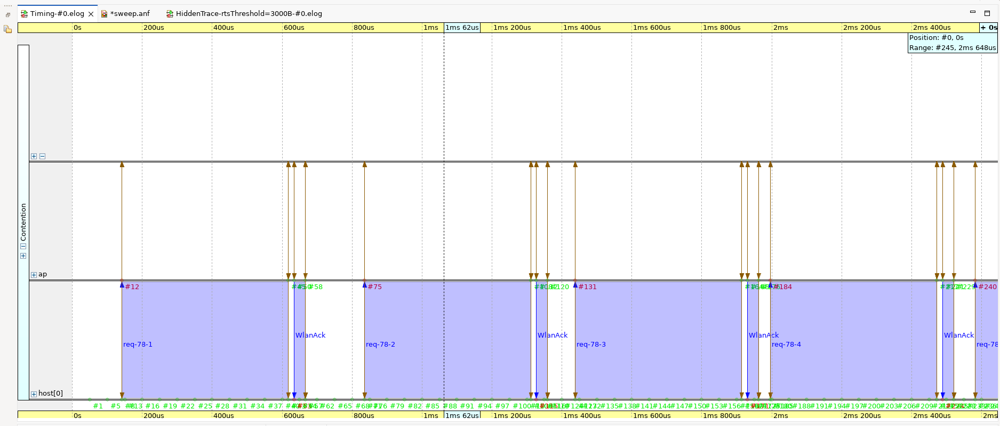
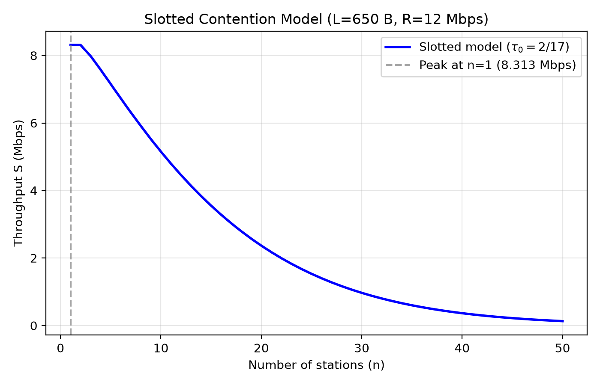
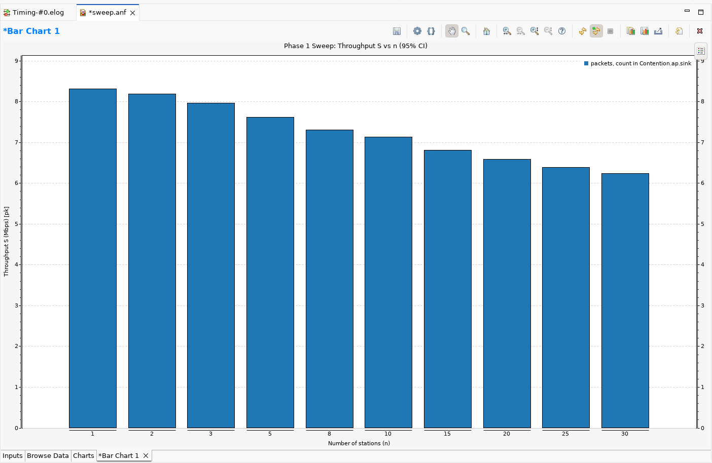
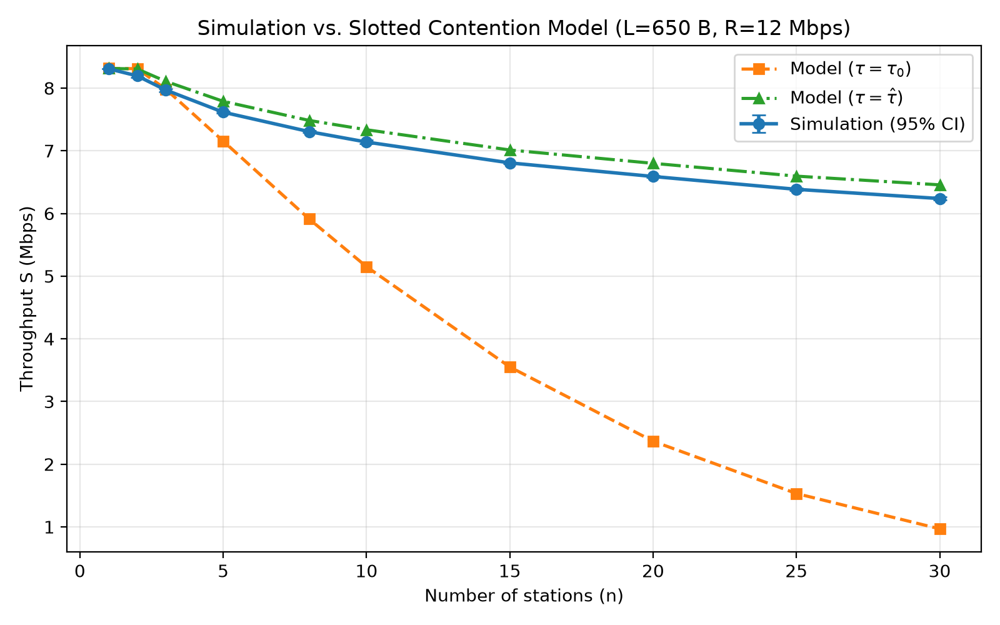
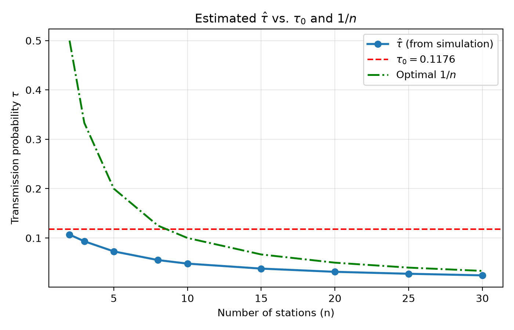
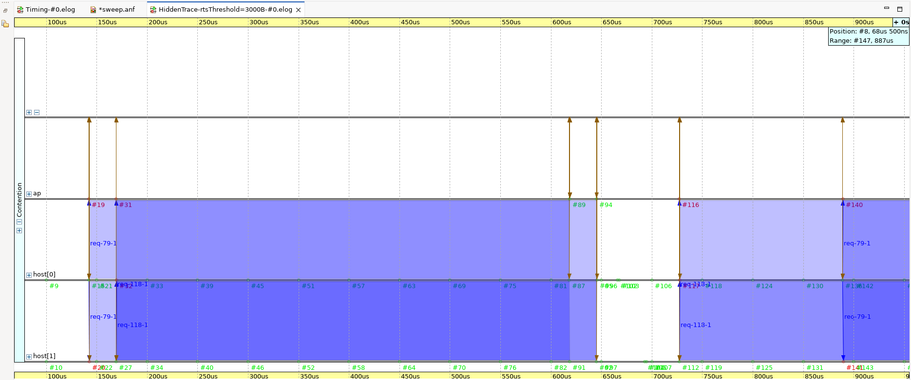
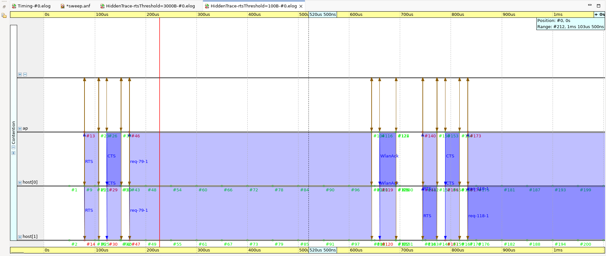

<docheader title="گزارش فاز اول: رقابت برای کانال، DCF و مدل شکاف‌دار" subtitle="درس شبکه‌های کامپیوتری — تمرین کامپیوتری شمارهٔ ۲" subtitle2="دانشگاه تهران — شماره‌های دانشجویی: ۸۱۰۱۰۲۴۴۱ و ۸۱۰۱۰۲۴۴۲"></docheader>

## پارامترهای اختصاصی گروه {#sec-p1-params}

مقادیر اختصاصی گروه بر اساس شماره‌های دانشجویی `810102441` و `810102442` توسط اسکریپت `ca2_params.py` تولید شده و در <ref to="tbl-p1-params"></ref> آمده است.

{caption="پارامترهای اختصاصی گروه در فاز اول" #tbl-p1-params}
| پارامتر | مقدار | توضیح |
| :---: | :---: | :--- |
| $L$ | $650\,\text{B}$ | اندازهٔ دادهٔ مفید هر فریم |
| $R$ | $12\,\text{Mbps}$ | نرخ ارسال داده در استاندارد 802.11a |

## جدول پیش‌بینی‌های فاز اول {#sec-p1-predictions}

پیش‌بینی‌های انجام‌شده پیش از اجرای شبیه‌سازی‌ها، استدلال، نتیجهٔ واقعی اجرا و علت اختلاف در <ref to="tbl-p1-predictions"></ref> گزارش شده است.

{caption="جدول پیش‌بینی‌های فاز اول" #tbl-p1-predictions}
| پرسش | پیش‌بینی | استدلال | نتیجهٔ اجرا | علت اختلاف |
| :--- | :--- | :--- | :--- | :--- |
| پرسش ۳-۵ ($n = 30$) | گذردهی شبیه‌سازی در $n = 30$ به مدل با $\tau_0$ نزدیک **نیست** و بسیار بالاتر از آن خواهد بود. | در $n = 30$ مقدار $\tau_0 = 2/17 \approx 0.1176$ بسیار بزرگ‌تر از مقدار بهینهٔ $1/30 \approx 0.0333$ است و در مدل بدون پس‌نشینی منجر به برخورد شدید می‌شود؛ اما در شبیه‌سازی، پس‌نشینی نمایی دودویی با دو برابر کردن $CW$ پس از هر برخورد، $\tau$ را کاهش داده و گذردهی را بالا نگه می‌دارد. | مقدار شبیه‌سازی $S_{\text{sim}}(30) = 6.2377 \pm 0.0279\,\text{Mbps}$ است در حالی که مدل مقدار $S(30, \tau_0) = 0.9682\,\text{Mbps}$ را می‌دهد. | پیش‌بینی درست بود؛ مدل با $\tau_0$ فرض می‌کند $CW = CW_{\min}$ ثابت است و پس‌نشینی نمایی را لحاظ نمی‌کند (خطای نسبی ۸۴.۴۸٪). |
| پرسش ۳-۸ (پایانهٔ پنهان) | بدون RTS/CTS برخوردهای مکرر رخ می‌دهد، گذردهی کل کاهش می‌یابد و ممکن است یک ایستگاه سهم بیشتری بگیرد (بی‌عدالتی). با فعال کردن RTS/CTS برخورد فریم‌های داده از بین می‌رود و انصاف نزدیک به ۱ می‌شود، اما به‌دلیل سربار RTS/CTS ممکن است گذردهی کل برای $L = 650\,\text{B}$ و $R = 12\,\text{Mbps}$ افزایش چشمگیری نداشته باشد یا کمی کاهش یابد. | دو ایستگاه در فاصلهٔ ۲۰۰ متری با توان دریافتی $-79.73\,\text{dBm}$ زیر آستانهٔ $-77\,\text{dBm}$ قرار دارند و یکدیگر را نمی‌شنوند. بدون RTS/CTS، ارسال‌های هم‌زمان در AP برخورد می‌کنند. با RTS/CTS، پاسخ CTS از AP (با توان $-73.71\,\text{dBm}$) به هر دو ایستگاه می‌رسد و با تنظیم NAV جلوی برخورد داده را می‌گیرد، ولی هر ارسال موفق سربار اضافی `RTS + CTS + 2*SIFS` می‌پردازد. | بدون RTS/CTS گذردهی $S_{\text{tot}} = 6.6266 \pm 0.0940\,\text{Mbps}$ و $J = 0.8948 \pm 0.1039$ شد. با RTS/CTS گذردهی $S_{\text{tot}} = 6.3440 \pm 0.0402\,\text{Mbps}$ و $J = 0.9948 \pm 0.0100$ شد. | پیش‌بینی درست بود؛ با $L = 650\,\text{B}$ و $R = 12\,\text{Mbps}$، صرفه‌جویی مورد انتظار از حذف برخوردها ($77.8\,\mu\text{s}$ به‌ازای هر ارسال موفق) کمتر از سربار RTS/CTS ($100.0\,\mu\text{s}$) است. |

## بررسی زمان‌بندی یک تبادل فریم {#sec-p1-timing}

### پارامترهای DCF و سرآیندهای فریم {#sec-p1-q3-1}

**پاسخ سؤال ۳-۱:** پارامترهای DCF در استاندارد 802.11a در شبیه‌ساز INET به شرح زیر است:

- کمینهٔ پنجرهٔ رقابت: $CW_{\min} = 15$
- بیشینهٔ پنجرهٔ رقابت: $CW_{\max} = 1023$
- طول شکاف زمانی: $\sigma = 9\,\mu\text{s}$
- فاصلهٔ کوتاه میان‌فریمی: $\text{SIFS} = 16\,\mu\text{s}$
- فاصلهٔ DCF میان‌فریمی: $\text{DIFS} = \text{SIFS} + 2\sigma = 16 + 2(9) = 34\,\mu\text{s}$

سرآیندهای افزوده‌شده به $L = 650\,\text{B}$ داده (استخراج‌شده از Qtenv و فایل `Timing-#0.elog`) عبارت‌اند از:

- دادهٔ کاربردی (`EtherAppClient`): برابر $L = 650\,\text{B}$ (`5200 bits`)
- سرآیند لایهٔ LLC (`Ieee8022LlcHeader`): برابر $3\,\text{B}$ (`5200 -> 5224 bits`)
- سرآیند و دنبالهٔ لایهٔ MAC (`Ieee80211DataHeader` و `FCS`): برابر $24 + 4 = 28\,\text{B}$ (`5224 -> 5448 bits`)
- اندازهٔ کل فریم MAC داده: $B_{\text{DATA}} = 650 + 3 + 28 = 681\,\text{B}$
- اندازهٔ کل فریم MAC تأییدیه (ACK): $B_{\text{ACK}} = 10 + 4 = 14\,\text{B}$

### مقایسهٔ زمان‌های محاسبه‌شده و اندازه‌گیری‌شده {#sec-p1-q3-2}

**پاسخ سؤال ۳-۲:** با نرخ $R = 12\,\text{Mbps}$ و تعداد بیت داده در هر نماد OFDM برابر $N_{\text{DBPS}} = 4r = 48$ داریم:

$$
T_{\text{DATA}} = T_{\text{PPDU}}(681, 12) = 20 + 4 \left\lceil \frac{16 + 8(681) + 6}{48} \right\rceil = 20 + 4 \times 114 = 476\,\mu\text{s}
$$

دربارهٔ نرخ ارسال ACK و قاعدهٔ انتخاب آن در INET: در فایل `RateSelection.cc` (خط ۸۷)، INET نرخ پاسخ ACK را با عبارت `modeSet->getIsMandatory(mode) ? mode : modeSet->getSlowerMandatoryMode(mode)` انتخاب می‌کند؛ یعنی اگر نرخ فریم داده جزو نرخ‌های اجباری استاندارد 802.11a ($6, 12, 24\,\text{Mbps}$) باشد با همان نرخ، وگرنه با نزدیک‌ترین نرخ اجباری پایین‌تر ارسال می‌شود. چون نرخ گروه ما $R = 12\,\text{Mbps}$ خود یک نرخ اجباری است، ACK نیز با نرخ **$r_{\text{ACK}} = 12\,\text{Mbps}$** ارسال می‌شود:

$$
T_{\text{ACK}} = T_{\text{PPDU}}(14, 12) = 20 + 4 \left\lceil \frac{16 + 8(14) + 6}{48} \right\rceil = 20 + 4 \times 3 = 32\,\mu\text{s}
$$

نمودار زمانی چند تبادل متوالی در پیکربندی `Timing` در <ref to="fig-p1-timing"></ref> و مقایسهٔ مقادیر محاسبه‌شده و اندازه‌گیری‌شده در <ref to="tbl-p1-timing"></ref> نشان داده شده است.

<fig id="fig-p1-timing" align="center" width="100%">

<caption>نمودار Sequence Chart برای چند تبادل متوالی در پیکربندی Timing (فایل Timing-#0.elog با محور زمان خطی).</caption>
</fig>

{caption="مقایسهٔ زمان‌های اندازه‌گیری‌شده از Sequence Chart و مقادیر محاسبه‌شده برای تبادل اول" #tbl-p1-timing}
| جزء تبادل | مقدار محاسبه‌شده ($\mu\text{s}$) | مقدار اندازه‌گیری‌شده ($\mu\text{s}$) | توضیح |
| :--- | :---: | :---: | :--- |
| فریم داده ($T_{\text{DATA}}$) | $476.0$ | $476.0$ | بازهٔ `142.0` تا `618.0` $\mu\text{s}$ |
| فاصلهٔ SIFS | $16.0$ | $16.0$ | بازهٔ `618.033` تا `634.033` $\mu\text{s}$ |
| فریم تأییدیه ($T_{\text{ACK}}$) | $32.0$ | $32.0$ | بازهٔ `634.033` تا `666.033` $\mu\text{s}$ |
| فاصلهٔ DIFS | $34.0$ | $34.0$ | بخشی از فاصلهٔ `666.067` تا `835.067` $\mu\text{s}$ |
| پس‌نشینی ($k \cdot \sigma$) | $k \times 9.0$ | $135.0$ (برای $k = 15$) | برابر $201.0 - 32.0 - 34.0 = 135.0\,\mu\text{s}$ |

مقادیر $k$ برای پنج تبادل متوالی استخراج‌شده از `Timing-#0.elog` عبارت‌اند از:

1. پس از `req-78-1`: فاصلهٔ شروع `req-78-2` تا دریافت ACK اول برابر $201\,\mu\text{s}$ است، پس $k = (201 - 32 - 34)/9 = \mathbf{15}$.
2. پس از `req-78-2`: فاصلهٔ شروع `req-78-3` تا دریافت ACK دوم برابر $111\,\mu\text{s}$ است، پس $k = (111 - 32 - 34)/9 = \mathbf{5}$.
3. پس از `req-78-3`: فاصلهٔ شروع `req-78-4` تا دریافت ACK سوم برابر $66\,\mu\text{s}$ است، پس $k = (66 - 32 - 34)/9 = \mathbf{0}$.
4. پس از `req-78-4`: فاصلهٔ شروع `req-78-5` تا دریافت ACK چهارم برابر $93\,\mu\text{s}$ است، پس $k = (93 - 32 - 34)/9 = \mathbf{3}$.
5. پس از `req-78-5`: فاصلهٔ شروع `req-78-6` تا دریافت ACK پنجم برابر $165\,\mu\text{s}$ است، پس $k = (165 - 32 - 34)/9 = \mathbf{11}$.

### گذردهی تحلیلی با یک ایستگاه {#sec-p1-q3-3}

**پاسخ سؤال ۳-۳:** برای یک ایستگاه با $CW_{\min} = 15$، عدد $k$ به‌طور یکنواخت از مجموعهٔ $\{0, 1, \dots, 15\}$ انتخاب می‌شود؛ بنابراین $\bar{k} = CW_{\min} / 2 = 7.5$ و گذردهی تحلیلی برابر است با:

$$
S_1 = \frac{8 \times 650}{34 + 7.5 \times 9 + 476 + 16 + 32} = \frac{5200}{625.5\,\mu\text{s}} \approx \mathbf{8.3133\,\text{Mbps}}
$$

مقدار گذردهی شبیه‌سازی در $n = 1$ برابر $\mathbf{8.3080 \pm 0.0024\,\text{Mbps}}$ است که بسیار نزدیک به $S_1$ بوده و اختلاف ناچیز (حدود $0.06\%$) ناشی از تأخیر انتشار، واریانس نمونه‌برداری محدود در بازهٔ ۱۰ ثانیه‌ای و اثر مرزهای شروع و پایان بازهٔ اندازه‌گیری است.

## مدل شکاف‌دار رقابت {#sec-p1-slotted}

### تحلیل مدل با احتمال ارسال ثابت {#sec-p1-q3-4}

**پاسخ سؤال ۳-۴:** با احتمال ارسال ثابت $\tau_0 = \frac{2}{CW_{\min} + 2} = \frac{2}{17} \approx 0.117647$، در حالت $n = 1$ داریم $P_{\text{idle}} = 1 - \tau_0$، $P_s = \tau_0$ و $P_c = 0$:

$$
S(1, \tau_0) = \frac{\tau_0 \cdot 8L}{(1 - \tau_0)\sigma + \tau_0 T_s} = \frac{8L}{\frac{1 - \tau_0}{\tau_0}\sigma + T_s} = \frac{8L}{\frac{CW_{\min}}{2}\sigma + T_s} = S_1 = \mathbf{8.3133\,\text{Mbps}}
$$

همان‌طور که در <ref to="fig-p1-slotted"></ref> دیده می‌شود، برای $n = 1, \dots, 50$ بیشترین گذردهی مدل با $\tau_0$ در **$n = 1$** با مقدار **$8.3133\,\text{Mbps}$** رخ می‌دهد. چون $\tau_0 = 2/17$ نسبتاً بزرگ است، با افزایش $n$ اثر افزایش برخوردها سریع‌تر از کاهش زمان بیکاری عمل کرده و گذردهی به‌طور پیوسته کاهش می‌یابد.

<fig id="fig-p1-slotted" align="center" width="85%">

<caption>گذردهی مدل شکاف‌دار رقابت با احتمال ارسال ثابت به ازای تعداد ایستگاه‌های ۱ تا ۵۰.</caption>
</fig>

### بیشینه‌سازی احتمال موفقیت و نقش پس‌نشینی نمایی {#sec-p1-q3-5}

**پاسخ سؤال ۳-۵:** با مشتق‌گیری از احتمال موفقیت یک شکاف یعنی $P_s(\tau) = n\tau(1-\tau)^{n-1}$ نسبت به $\tau$ و برابر صفر قرار دادن آن داریم:

$$
\frac{dP_s}{d\tau} = n(1-\tau)^{n-1} - n(n-1)\tau(1-\tau)^{n-2} = n(1-\tau)^{n-2}(1 - n\tau) = 0 \implies \tau^* = \frac{1}{n}
$$

برای $n$ بزرگ، مقدار بیشینهٔ $P_s$ به حد زیر میل می‌کند:

$$
\lim_{n \to \infty} n\left(\frac{1}{n}\right)\left(1 - \frac{1}{n}\right)^{n-1} = \frac{1}{e} \approx 0.3679
$$

با مقایسهٔ $\tau_0$ و $1/n$ به دست می‌آوریم:

$$
\tau_0 = \frac{2}{17} > \frac{1}{n} \iff n > 8.5 \implies n \ge 9
$$

از $n = 9$ به بعد، $\tau_0$ از مقدار بهینهٔ $1/n$ بزرگ‌تر می‌شود که باعث افزایش شدید احتمال برخورد و افت سریع گذردهی در مدل با $\tau_0$ ثابت می‌گردد. در DCF واقعی، **پس‌نشینی نمایی دودویی** بدون نیاز به دانستن $n$، پس از هر برخورد $CW$ را دو برابر می‌کند؛ هرچه $n$ بزرگ‌تر باشد برخوردهای بیشتری رخ می‌دهد، در نتیجه $CW$ به‌طور خودکار بزرگ‌تر شده و احتمال ارسال مؤثر $\tau$ به سمت مقدار مناسب (نزدیک‌تر به $1/n$) کاهش می‌یابد.

## مقایسهٔ مدل و شبیه‌سازی {#sec-p1-sweep}

### برآورد احتمال برخورد از آماره‌های شبیه‌سازی {#sec-p1-q3-6}

**پاسخ سؤال ۳-۶:** برآورد $\hat{p} = \frac{N_{\text{retry}} + N_{\text{drop}}}{N_{\text{retry}} + N_{\text{first}}}$ معیار مناسبی برای احتمال برخورد $p$ است، زیرا:

- **مخرج کسر ($N_{\text{retry}} + N_{\text{first}}$):** تعداد کل تلاش‌های ارسال انجام‌شده توسط همهٔ ایستگاه‌ها را می‌شمارد؛ زیرا هر فریم دقیقاً یک تلاش نخست (`WithoutRetry`) و به تعداد تلاش‌های مجددش (`WithRetry`) ارسال دارد.
- **صورت کسر ($N_{\text{retry}} + N_{\text{drop}}$):** تعداد کل تلاش‌های ناموفق (برخوردها) را می‌شمارد؛ زیرا هر تلاش ناموفق یا به یک تلاش مجدد (`WithRetry`) منجر می‌شود یا اگر به سقف تلاش برسد، به حذف فریم (`DropRetryLimitReached`) می‌انجامد.

### نتایج مطالعهٔ پارامتری و مقایسه با مدل {#sec-p1-q3-7}

**پاسخ سؤال ۳-۷:** نمودار خروجی **Analysis Tool** محیط OMNeT++ برای گذردهی $S$ بر حسب $n$ با بازهٔ اطمینان ۹۵٪ در <ref to="fig-p1-analysis"></ref> آمده است. همچنین نتایج کامل ۵ تکرار `Sweep` در <ref to="tbl-p1-sweep"></ref> و مقایسهٔ گرافیکی شبیه‌سازی با دو مدل ($\tau_0$ ثابت و $\hat{\tau}$) در <ref to="fig-p1-model-vs-sim"></ref> و <ref to="fig-p1-tau"></ref> نمایش داده شده است.

<fig id="fig-p1-analysis" align="center" width="95%">

<caption>نمودار گذردهی بر حسب تعداد ایستگاه‌ها با بازهٔ اطمینان ۹۵ درصد در ابزار Analysis Tool محیط OMNeT++.</caption>
</fig>

{caption="مقایسهٔ نتایج شبیه‌سازی Sweep (میانگین ۵ تکرار با بازهٔ اطمینان ۹۵٪) با دو مدل تحلیلی" #tbl-p1-sweep}
| $n$ | $S_{\text{sim}}$ (Mbps) | $S(\tau_0)$ (Mbps) | $S(\hat{\tau})$ (Mbps) | $\hat{p}$ | $\hat{\tau}$ | $1/n$ |
| :---: | :---: | :---: | :---: | :---: | :---: | :---: |
| $1$ | $8.3080 \pm 0.0024$ | $8.3133$ | $8.3133$ | $0.0000$ | $0.1176$ | $1.0000$ |
| $2$ | $8.1947 \pm 0.0261$ | $8.3100$ | $8.3051$ | $0.1069$ | $0.1069$ | $0.5000$ |
| $3$ | $7.9684 \pm 0.0252$ | $7.9813$ | $8.1067$ | $0.1780$ | $0.0933$ | $0.3333$ |
| $5$ | $7.6154 \pm 0.0197$ | $7.1539$ | $7.7887$ | $0.2612$ | $0.0729$ | $0.2000$ |
| $8$ | $7.3052 \pm 0.0168$ | $5.9112$ | $7.4836$ | $0.3284$ | $0.0553$ | $0.1250$ |
| $10$ | $7.1391 \pm 0.0321$ | $5.1511$ | $7.3354$ | $0.3584$ | $0.0481$ | $0.1000$ |
| $15$ | $6.8066 \pm 0.0098$ | $3.5510$ | $7.0124$ | $0.4188$ | $0.0380$ | $0.0667$ |
| $20$ | $6.5896 \pm 0.0158$ | $2.3662$ | $6.7994$ | $0.4554$ | $0.0315$ | $0.0500$ |
| $25$ | $6.3849 \pm 0.0225$ | $1.5320$ | $6.5953$ | $0.4886$ | $0.0276$ | $0.0400$ |
| $30$ | $6.2377 \pm 0.0279$ | $0.9682$ | $6.4563$ | $0.5102$ | $0.0243$ | $0.0333$ |

<fig id="fig-p1-model-vs-sim" align="center" width="85%">

<caption>مقایسهٔ گذردهی شبیه‌سازی با بازهٔ اطمینان ۹۵ درصد در برابر مدل با احتمال ارسال ثابت و مدل با احتمال ارسال مؤثر.</caption>
</fig>

<fig id="fig-p1-tau" align="center" width="85%">

<caption>مقایسهٔ احتمال ارسال مؤثر در شبیه‌سازی با مقدار ثابت و مقدار بهینه بر حسب تعداد ایستگاه‌ها.</caption>
</fig>

مشاهدات کلیدی این مقایسه عبارت‌اند از:

- مدل با $\hat{\tau}$ بسیار به شبیه‌سازی نزدیک‌تر است و با افزایش $n$، مقدار $\hat{\tau}$ از $\tau_0$ فاصله گرفته و به $1/n$ نزدیک می‌شود (در $n = 30$: $\hat{\tau} = 0.0243$ و $1/n = 0.0333$). این نشان می‌دهد پس‌نشینی نمایی دودویی نرخ ارسال را به‌خوبی با تعداد ایستگاه‌ها تطبیق می‌دهد و از فروپاشی شبکه جلوگیری می‌کند.
- خطای نسبی مدل با $\tau_0$ در $n = 30$ برابر **۸۴.۴۸٪** است.
- خطای نسبی مدل با $\hat{\tau}$ در $n = 30$ برابر **۳.۵۰٪** است؛ همان‌طور که انتظار می‌رفت، مدل با $\hat{\tau}$ گذردهی را اندکی بیشتر از شبیه‌سازی برآورد می‌کند.

## پایانهٔ پنهان و RTS/CTS {#sec-p1-hidden}

### محاسبهٔ توان دریافتی و علت پنهان بودن ایستگاه‌ها {#sec-p1-q3-8}

**پاسخ سؤال ۳-۸:** با توان فرستنده $P_t = 20\,\text{mW}$ ($\approx 13.01\,\text{dBm}$) و فرکانس مرکزی $f_c = 5.17\,\text{GHz}$ (طول موج $\lambda = c/f_c \approx 0.057987\,\text{m}$)، توان دریافتی در مدل اتلاف فضای آزاد عبارت است از:

- توان دریافتی هر ایستگاه از AP در فاصلهٔ $d = 100\,\text{m}$:

$$
P_r(100) = 10 \log_{10}\left(20 \cdot \left(\frac{\lambda}{4\pi \cdot 100}\right)^2\right) = \mathbf{-73.71\,\text{dBm}} > -77\,\text{dBm}
$$

- توان دریافتی هر ایستگاه از ایستگاه دیگر در فاصلهٔ $d = 200\,\text{m}$:

$$
P_r(200) = 10 \log_{10}\left(20 \cdot \left(\frac{\lambda}{4\pi \cdot 200}\right)^2\right) = \mathbf{-79.73\,\text{dBm}} < -77\,\text{dBm}
$$

بنابراین هر ایستگاه سیگنال AP را با توان بالاتر از آستانهٔ $-77\,\text{dBm}$ دریافت می‌کند، اما سیگنال ایستگاه دیگر پایین‌تر از آستانهٔ آشکارسازی است و دو ایستگاه از یکدیگر پنهان‌اند.

### مقایسهٔ عملکرد بدون RTS/CTS و با RTS/CTS {#sec-p1-q3-9}

**پاسخ سؤال ۳-۹:** نتایج ۵ اجرای پیکربندی `Hidden` در <ref to="tbl-p1-hidden"></ref> گزارش شده است.

{caption="مقایسهٔ گذردهی، انصاف و احتمال برخورد در سناریوی پایانهٔ پنهان (۵ تکرار)" #tbl-p1-hidden}
| حالت | $S_{\text{tot}}$ (Mbps) | $S_0$ (Mbps) | $S_1$ (Mbps) | شاخص Jain ($J$) | $\hat{p}$ |
| :--- | :---: | :---: | :---: | :---: | :---: |
| بدون RTS/CTS (`3000B`) | $6.6266 \pm 0.0940$ | $3.8040 \pm 1.4807$ | $2.8224 \pm 1.4629$ | $0.8948 \pm 0.1039$ | $0.2612$ |
| با RTS/CTS (`100B`) | $6.3440 \pm 0.0402$ | $3.0229 \pm 0.2566$ | $3.3212 \pm 0.2315$ | $0.9948 \pm 0.0100$ | $0.0025$ |

تحلیل رفتار زمانی از دو تصویر Sequence Chart در پیکربندی `HiddenTrace`:

- **حالت بدون RTS/CTS (<ref to="fig-p1-hidden-coll"></ref>):** ایستگاه `host[0]` ارسال فریم داده (`req-79-1`) را در $t = 142\,\mu\text{s}$ آغاز می‌کند. ایستگاه `host[1]` که سیگنال آن را نمی‌شنود، کانال را آزاد پنداشته و در $t = 169\,\mu\text{s}$ ارسال `req-118-1` را شروع می‌کند که منجر به هم‌پوشانی و برخورد در `ap` و عدم ارسال `ACK` می‌شود.
- **حالت با RTS/CTS (<ref to="fig-p1-hidden-rts"></ref>):** ایستگاه `host[0]` در $t = 79\,\mu\text{s}$ یک فریم `RTS` به `ap` می‌فرستد. نقطهٔ دسترسی در $t = 123.33\,\mu\text{s}$ با `CTS` پاسخ می‌دهد که توسط هر دو ایستگاه دریافت می‌شود؛ `host[1]` با خواندن فیلد Duration در `CTS`، بردار **NAV** خود را تنظیم کرده و تا پایان `SIFS + DATA + SIFS + ACK` سکوت می‌کند و تنها پس از دریافت `WlanAck` نوبت ارسال خود را با `RTS` آغاز می‌نماید.

<fig id="fig-p1-hidden-coll" align="center" width="100%">

<caption>وقوع برخورد میان دو ایستگاه پنهان در حالت بدون RTS/CTS (فایل HiddenTrace-rtsThreshold=3000B-#0.elog).</caption>
</fig>

<fig id="fig-p1-hidden-rts" align="center" width="100%">

<caption>جلوگیری از برخورد با استفاده از RTS/CTS و تنظیم NAV توسط ایستگاه دوم (فایل HiddenTrace-rtsThreshold=100B-#0.elog).</caption>
</fig>

همان‌طور که در <ref to="tbl-p1-hidden"></ref> دیده می‌شود، استفاده از RTS/CTS گذردهی کل را افزایش **نداده** (کاهش جزئی از $6.63$ به $6.34\,\text{Mbps}$)، اما **انصاف (شاخص Jain)** را از $0.895$ به $0.995$ ارتقا داده و احتمال برخورد ($\hat{p}$) را از $26.12\%$ به $0.25\%$ کاهش داده است.

### تحلیل سربار و صرفه‌جویی RTS/CTS {#sec-p1-q3-10}

**پاسخ سؤال ۳-۱۰:** اندازهٔ فریم `RTS` برابر $20\,\text{B}$ و فریم `CTS` برابر $14\,\text{B}$ است و هر دو با نرخ $r_{\text{ACK}} = 12\,\text{Mbps}$ ارسال می‌شوند:

- مدت ارسال `RTS`: برابر $T_{\text{RTS}} = T_{\text{PPDU}}(20, 12) = 20 + 4\lceil(16 + 160 + 6)/48\rceil = 36\,\mu\text{s}$
- مدت ارسال `CTS`: برابر $T_{\text{CTS}} = T_{\text{PPDU}}(14, 12) = 32\,\mu\text{s}$
- **سربار هر ارسال موفق:**

$$
\text{Overhead} = T_{\text{RTS}} + T_{\text{CTS}} + 2 \cdot \text{SIFS} = 36 + 32 + 2(16) = \mathbf{100.0\,\mu\text{s}}
$$

- **صرفه‌جویی هر برخورد:**

$$
\text{Saving per collision} = T_{\text{DATA}} - T_{\text{RTS}} = 476 - 36 = \mathbf{440.0\,\mu\text{s}}
$$

از اجرای `Hidden` بدون RTS/CTS مقدار $\hat{p} = 0.2612$ به دست آمد. چون در هر برخورد ۲ فریم ناموفق وجود دارد، نسبت تعداد برخوردها به ارسال‌های موفق برابر است با:

$$
\frac{N_{\text{coll}}}{N_{\text{succ}}} = \frac{\hat{p}}{2(1 - \hat{p})} = \frac{0.2612}{2(1 - 0.2612)} \approx \mathbf{0.1767}
$$

بنابراین **صرفه‌جویی مورد انتظار به‌ازای هر ارسال موفق** برابر است با:

$$
0.1767 \times 440.0\,\mu\text{s} \approx \mathbf{77.8\,\mu\text{s}}
$$

چون صرفه‌جویی مورد انتظار ($77.8\,\mu\text{s}$) از سربار ($100.0\,\mu\text{s}$) **کمتر** است، استفاده از RTS/CTS برای $L = 650\,\text{B}$ و $R = 12\,\text{Mbps}$ گذردهی کل را اندکی کاهش می‌دهد؛ این نتیجه کاملاً با کاهش گذردهی اندازه‌گیری‌شده ($6.6266 \to 6.3440\,\text{Mbps}$) هم‌خوانی دارد. برای **فریم‌های بلندتر** (افزایش $L$) یا **نرخ پایین‌تر** (کاهش $R$)، مدت $T_{\text{DATA}}$ بسیار بزرگ‌تر می‌شود؛ در نتیجه صرفه‌جویی هر برخورد ($T_{\text{DATA}} - T_{\text{RTS}}$) افزایش یافته و از سربار ثابت $100\,\mu\text{s}$ پیشی می‌گیرد و در آن شرایط RTS/CTS گذردهی کل را نیز بهبود خواهد داد.
