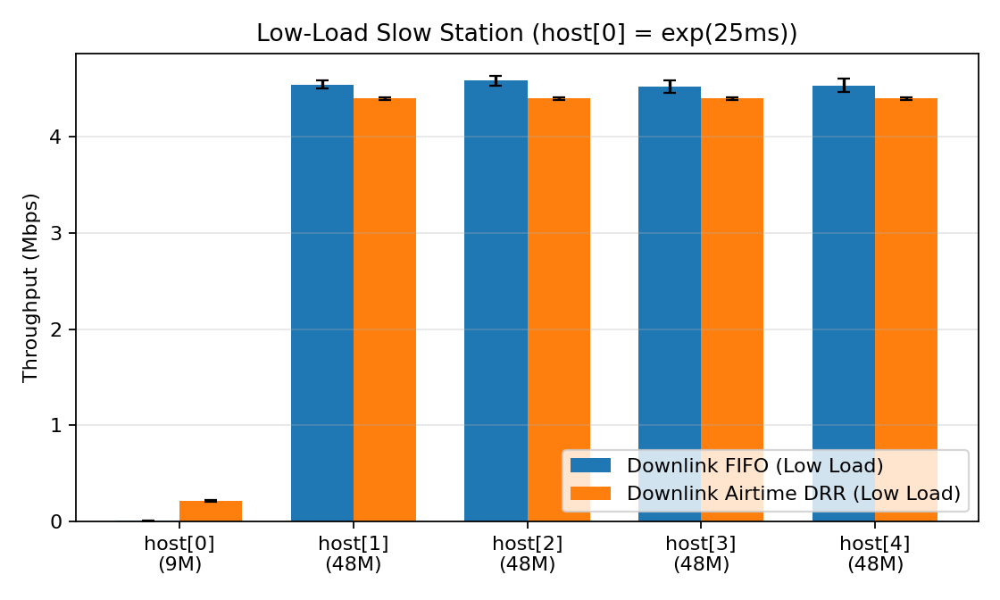

# گزارش فاز دوم: ناهنجاری کارایی و انصاف در زمان استفاده از کانال

## پارامترهای اختصاصی گروه

شماره‌های دانشجویی: `810102441` و `810102442`

| پارامتر | مقدار | توضیح |
| --- | --- | --- |
| $n_2$ | $5$ | تعداد ایستگاه‌ها (`host[0]` کند، `host[1..4]` سریع) |
| $L$ | $650\,\text{B}$ | اندازهٔ دادهٔ هر بستهٔ UDP |
| $R_{\text{slow}}$ | $9\,\text{Mbps}$ | نرخ ارسال دادهٔ ایستگاه کند (`host[0]`) |
| $R_{\text{fast}}$ | $48\,\text{Mbps}$ | نرخ ارسال دادهٔ ایستگاه‌های سریع (`host[1..4]`) |

---

## جدول پیش‌بینی‌های فاز دوم

| پرسش | پیش‌بینی | استدلال | نتیجهٔ اجرا | علت اختلاف |
| --- | --- | --- | --- | --- |
| **سؤال ۴-۴** (پیش‌بینی گذردهی `DownlinkAirtime`) | $S_0 \approx 0.8480\,\text{Mbps}$ برای ایستگاه کند، $S_{1..4} \approx 3.9493\,\text{Mbps}$ برای هر ایستگاه سریع، و $S_{\text{tot}} \approx 16.6453\,\text{Mbps}$. | زمان‌بند Airtime DRR مجموع `headAirtime` ($T_{\text{DATA}, i}$) را برای همهٔ صف‌های پر برابر می‌کند؛ بنابراین تعداد فریم‌های ارسالی هر ایستگاه با $1/T_{\text{DATA}, i}$ متناسب است. با قرار دادن $N_i \propto 1/T_{\text{DATA}, i}$ در بودجهٔ کل زمان کانال، $S_i = \frac{8L / T_{\text{DATA}, i}}{\sum_j T_{\text{exch}, j}/T_{\text{DATA}, j}}$ به دست می‌آید. | $S_0 = 0.8378 \pm 0.0008\,\text{Mbps}$، $S_{1..4} \approx 3.9497\,\text{Mbps}$، $S_{\text{tot}} = 16.6367 \pm 0.0194\,\text{Mbps}$. | اختلاف برای ایستگاه‌های سریع تنها `0.01%` و برای ایستگاه کند `1.20%` است. این اختلاف جزئی ناشی از گسسته‌بودن `quantum = 500 us` و تفاوت اندک میانگین backoff در شبیه‌سازی نسبت به مقدار نظری $\frac{CW_{\min}}{2}\sigma$ است. |

---

## ۴.۱ ناهنجاری در مسیر بالارونده و پایین‌رونده

### سؤال ۴-۱
- **سرآیندهای افزوده‌شده به $L = 650\,\text{B}$ دادهٔ کاربردی (`UdpBasicApp`):**
  - دادهٔ کاربردی (UDP payload): $L = 650\,\text{B}$
  - سرآیند UDP: $8\,\text{B}$
  - سرآیند IPv4: $20\,\text{B}$
  - سرآیند LLC/EPD (`Ieee802EpdHeader`): $2\,\text{B}$
  - سرآیند و دنبالهٔ MAC (`Ieee80211DataHeader` + `FCS`): $24 + 4 = 28\,\text{B}$
  - **اندازهٔ MPDU (کل فریم MAC):** $B_{\text{DATA}} = 650 + 8 + 20 + 2 + 28 = 708\,\text{B}$
  - **اندازهٔ فریم ACK:** $B_{\text{ACK}} = 14\,\text{B}$
- **مدت زمان ارسال داده و ACK (با رابطهٔ PPDU استاندارد 802.11a):**
  - **ایستگاه کند (`host[0]`):** $R_{\text{slow}} = 9\,\text{Mbps}$ و نرخ اجباری متناظر برای ACK برابر $R_{\text{ACK, slow}} = 6\,\text{Mbps}$ ($N_{\text{DBPS}} = 36$ و $24$):
    $$T_{\text{DATA, slow}} = 20 + 4\left\lceil \frac{16 + 8(708) + 6}{36} \right\rceil = 20 + 4(158) = 652\,\mu\text{s}$$
    $$T_{\text{ACK, slow}} = 20 + 4\left\lceil \frac{16 + 8(14) + 6}{24} \right\rceil = 20 + 4(6) = 44\,\mu\text{s}$$
  - **ایستگاه سریع (`host[1..4]`):** $R_{\text{fast}} = 48\,\text{Mbps}$ و نرخ اجباری متناظر برای ACK برابر $R_{\text{ACK, fast}} = 24\,\text{Mbps}$ ($N_{\text{DBPS}} = 192$ و $96$):
    $$T_{\text{DATA, fast}} = 20 + 4\left\lceil \frac{16 + 8(708) + 6}{192} \right\rceil = 20 + 4(30) = 140\,\mu\text{s}$$
    $$T_{\text{ACK, fast}} = 20 + 4\left\lceil \frac{16 + 8(14) + 6}{96} \right\rceil = 20 + 4(2) = 28\,\mu\text{s}$$

### سؤال ۴-۲
نتایج ۵ اجرای `Uplink` و `DownlinkFifo`:

| پیکربندی | ایستگاه | گذردهی $S_i$ ($\text{Mbps}$) | سهم زمان کانال $a_i$ ($\%$) |
| --- | --- | :---: | :---: |
| **`Uplink`** | `host[0]` ($9\,\text{Mbps}$) | $2.2561 \pm 0.0317$ | $30.89\% \pm 0.43\%$ |
| **`Uplink`** | `host[1]` ($48\,\text{Mbps}$) | $2.5154 \pm 0.0556$ | $8.90\% \pm 0.20\%$ |
| **`Uplink`** | `host[2]` ($48\,\text{Mbps}$) | $2.6603 \pm 0.1669$ | $9.41\% \pm 0.59\%$ |
| **`Uplink`** | `host[3]` ($48\,\text{Mbps}$) | $2.6521 \pm 0.0820$ | $9.38\% \pm 0.29\%$ |
| **`Uplink`** | `host[4]` ($48\,\text{Mbps}$) | $2.4930 \pm 0.1643$ | $8.82\% \pm 0.58\%$ |
| **`Uplink` (جمع / انصاف)** | **کل** | $12.5769 \pm 0.1069$ | $J(S) = 0.9956 \pm 0.0013$، $J(a) = 0.7054 \pm 0.0094$ |
| **`DownlinkFifo`** | `host[0]` ($9\,\text{Mbps}$) | $2.6370 \pm 0.0309$ | $36.11\% \pm 0.42\%$ |
| **`DownlinkFifo`** | `host[1]` ($48\,\text{Mbps}$) | $2.6716 \pm 0.0396$ | $9.45\% \pm 0.14\%$ |
| **`DownlinkFifo`** | `host[2]` ($48\,\text{Mbps}$) | $2.6467 \pm 0.0241$ | $9.37\% \pm 0.09\%$ |
| **`DownlinkFifo`** | `host[3]` ($48\,\text{Mbps}$) | $2.6374 \pm 0.0240$ | $9.33\% \pm 0.09\%$ |
| **`DownlinkFifo`** | `host[4]` ($48\,\text{Mbps}$) | $2.6706 \pm 0.0525$ | $9.45\% \pm 0.19\%$ |
| **`DownlinkFifo` (جمع / انصاف)** | **کل** | $13.2633 \pm 0.0488$ | $J(S) = 0.9999 \pm 0.0001$، $J(a) = 0.6557 \pm 0.0075$ |

- **علت برابری گذردهی و نابرابری سهم زمان کانال:** در DCF (در `Uplink`) هر ایستگاه شانس برابری برای دسترسی به کانال و ارسال یک فریم دارد، و در `DownlinkFifo` نیز صف مشترک FIFO با بار ورودی برابر به هر ایستگاه تعداد برابری فریم می‌فرستد. چون همهٔ فریم‌ها اندازهٔ دادهٔ یکسان $L$ دارند، نرخ دریافت بیت ($S_i = 8L N_i / T$) برای همهٔ ایستگاه‌ها تقریباً برابر می‌شود ($J(S) \approx 1$). اما هر فریم ایستگاه کند حدود $3.86$ برابر فریم ایستگاه سریع زمان کانال مصرف می‌کند ($712\,\mu\text{s}$ در برابر $184\,\mu\text{s}$ برای داده+SIFS+ACK)؛ بنابراین ایستگاه کند به‌تنهایی بخش بزرگی از زمان کانال را اشغال کرده و شاخص انصاف زمان کانال ($J(a)$) پایین می‌آید.
- **سهم ایستگاه کند در `DownlinkFifo`:** از کل زمان اندازه‌گیری، **`36.11%`** (و از کل زمان اشغال مفید کانال `73.71%`، یعنی حدود **`49.0%`** از زمان تبادل‌های موفق) صرف فریم‌های `host[0]` می‌شود.

### سؤال ۴-۳
- **چرا در `DownlinkFifo` برخورد رخ نمی‌دهد؟** زیرا تنها فرستندهٔ فریم‌های داده در شبکه، AP است و هیچ ایستگاه دیگری هم‌زمان برای ارسال داده رقابت نمی‌کند (ایستگاه‌ها فقط پس از SIFS، فریم ACK می‌فرستند). در نتیجه هیچ دو فرستندهٔ داده‌ای هم‌زمان backoff را به صفر نمی‌رسانند و $CW$ همیشه روی $CW_{\min} = 15$ باقی می‌ماند.
- **اثبات رابطهٔ تحلیلی:** یک چرخهٔ کامل شامل ارسال یک فریم به هر یک از $n$ ایستگاه را در نظر می‌گیریم. متوسط زمان هر تبادل برای ایستگاه $j$ برابر است با:
  $$T_{\text{exch}, j} = \text{DIFS} + \frac{CW_{\min}}{2}\sigma + T_{\text{DATA}, j} + \text{SIFS} + T_{\text{ACK}, j}$$
  با مقادیر $\text{DIFS} = 34\,\mu\text{s}$، $\frac{CW_{\min}}{2}\sigma = 7.5 \times 9 = 67.5\,\mu\text{s}$ و $\text{SIFS} = 16\,\mu\text{s}$:
  - $T_{\text{exch, slow}} = 34 + 67.5 + 652 + 16 + 44 = 813.5\,\mu\text{s}$
  - $T_{\text{exch, fast}} = 34 + 67.5 + 140 + 16 + 28 = 285.5\,\mu\text{s}$
  در یک چرخه به مدت $\sum_j T_{\text{exch}, j}$، هر ایستگاه دقیقاً یک فریم ($8L$ بیت) دریافت می‌کند؛ پس گذردهی هر ایستگاه برابر است با:
  $$S = \frac{8L}{\sum_j \left(\text{DIFS} + \frac{CW_{\min}}{2}\sigma + T_{\text{DATA}, j} + \text{SIFS} + T_{\text{ACK}, j}\right)}$$
- **محاسبه و مقایسه:**
  - **با حضور ایستگاه کند ($1$ کند + $4$ سریع):**
    $$S_{\text{with slow}} = \frac{8 \times 650}{813.5 + 4 \times 285.5} = \frac{5200}{1955.5} = 2.6592\,\text{Mbps} \quad (\text{Total} = 13.2958\,\text{Mbps})$$
    که با میانگین شبیه‌سازی (`2.6566 Mbps` برای سریع‌ها و `13.2633 Mbps` کل) تطابق بسیار دقیق (اختلاف `0.24%`) دارد.
  - **بدون ایستگاه کند (فقط $4$ ایستگاه سریع):**
    $$S_{\text{without slow}} = \frac{5200}{4 \times 285.5} = \frac{5200}{1142.0} = 4.5534\,\text{Mbps}$$
  - **درصد کاهش گذردهی ایستگاه‌های سریع به‌دلیل حضور ایستگاه کند:**
    $$\frac{4.5534 - 2.6592}{4.5534} \times 100\% = 41.60\%$$

---

## ۴.۲ پیاده‌سازی زمان‌بند منصفانه استفاده از کانال

### سؤال ۴-۴ (پیش‌بینی پیش از اجرا)
اگر مجموع هزینهٔ منظور شده (`headAirtime`) برای همهٔ ایستگاه‌ها برابر با ثابت $C$ باشد، تعداد فریم‌های ارسالی ایستگاه $i$ برابر $N_i = C / T_{\text{DATA}, i}$ است. از آنجا که کل زمان اندازه‌گیری $T$ برابر مجموع زمان تبادل‌های همهٔ فریم‌هاست:
$$T = \sum_{j=0}^{n-1} N_j \, T_{\text{exch}, j} = C \sum_{j=0}^{n-1} \frac{T_{\text{exch}, j}}{T_{\text{DATA}, j}} \implies C = \frac{T}{\sum_{j=0}^{n-1} \frac{T_{\text{exch}, j}}{T_{\text{DATA}, j}}}$$
بنابراین گذردهی هر ایستگاه از رابطهٔ زیر به دست می‌آید:
$$S_i = \frac{8L \cdot N_i}{T} = \frac{8L / T_{\text{DATA}, i}}{\sum_{j=0}^{n-1} \frac{T_{\text{exch}, j}}{T_{\text{DATA}, j}}}$$
با جای‌گذاری مقادیر گروه:
$$\sum_{j=0}^{4} \frac{T_{\text{exch}, j}}{T_{\text{DATA}, j}} = \frac{813.5}{652} + 4 \times \frac{285.5}{140} = 1.2477 + 8.1571 = 9.4048$$
- $S_0 = \frac{5200 / 652}{9.4048} = 0.8480\,\text{Mbps}$
- $S_{1..4} = \frac{5200 / 140}{9.4048} = 3.9493\,\text{Mbps}$
- $S_{\text{tot}} = 0.8480 + 4 \times 3.9493 = 16.6453\,\text{Mbps}$

### سؤال ۴-۵ (نتایج شبیه‌سازی `DownlinkAirtime`)

| ایستگاه | گذردهی شبیه‌سازی ($\text{Mbps}$) | مدل تحلیلی ($\text{Mbps}$) | خطای نسبی ($\%$) | سهم زمان کانال $a_i$ ($\%$) |
| --- | :---: | :---: | :---: | :---: |
| `host[0]` ($9\,\text{Mbps}$) | $0.8378 \pm 0.0008$ | $0.8480$ | $1.20\%$ | $11.47\%$ |
| `host[1]` ($48\,\text{Mbps}$) | $3.9499 \pm 0.0051$ | $3.9493$ | $0.01\%$ | $13.98\%$ |
| `host[2]` ($48\,\text{Mbps}$) | $3.9496 \pm 0.0047$ | $3.9493$ | $0.01\%$ | $13.98\%$ |
| `host[3]` ($48\,\text{Mbps}$) | $3.9494 \pm 0.0045$ | $3.9493$ | $0.00\%$ | $13.97\%$ |
| `host[4]` ($48\,\text{Mbps}$) | $3.9499 \pm 0.0045$ | $3.9493$ | $0.01\%$ | $13.98\%$ |
| **کل / انصاف** | **$16.6367 \pm 0.0194$** | **$16.6453$** | **$0.05\%$** | $J(S) = 0.8772$، **$J(a) = 0.9945$** |

- **مقایسه با FIFO:** گذردهی کل **`+25.43%`** افزایش یافته (`13.2633 -> 16.6367 Mbps`) و گذردهی ایستگاه کند **`68.23%`** کاهش یافته است (`2.6370 -> 0.8378 Mbps`).
- **چرا $J(a)$ دقیقاً برابر $1$ نمی‌شود؟** تابع `headAirtime(i)` فقط مدت زمان ارسال فریم داده ($T_{\text{DATA}, i}$) را به عنوان هزینه کسر می‌کند و سربار ثابت هر فریم شامل `SIFS + T_ACK` (که در فرمول $a_i$ حساب می‌شود) را در نظر نمی‌گیرد. چون ایستگاه‌های سریع در بازهٔ یکسان حدود $4.7$ برابر بیشتر از ایستگاه کند فریم می‌فرستند، سهم $a_i$ آن‌ها به‌خاطر شمارش `SIFS + T_ACK` در هر فریم کمی بیشتر از ایستگاه کند می‌شود (`13.98%` در برابر `11.47%`)، در نتیجه $J(a) = 0.9945 < 1$ است.

### سؤال ۴-۶ (شرح و ردیابی دستی `schedulePacket()`)
تابع `schedulePacket()` ابتدا بررسی می‌کند آیا حداقل یک صف غیرخالی وجود دارد یا خیر؛ اگر همهٔ صف‌ها خالی باشند `-1` برمی‌گرداند. سپس در یک حلقه روی صف‌ها از اندیس `current` پیمایش می‌کند: اگر صف فعلی خالی باشد کسری آن را صفر کرده و به صف بعد می‌رود (تا ایستگاه بیکار اعتبار ذخیره نکند)؛ اگر صف غیرخالی باشد ولی `deficit[current] <= 0` باشد، یک `quantum` ($500\,\mu\text{s}$) به اعتبار آن اضافه کرده و نوبت را به صف بعدی می‌دهد؛ و اگر `deficit[current] > 0` باشد، مقدار `headAirtime(current)` را از کسری آن کم کرده و اندیس `current` را برای ارسال برمی‌گرداند.

**ردیابی ۱۰ تصمیم نخست** برای دو ایستگاه (`host[0]` کند با $T_{\text{DATA}} = 652\,\mu\text{s}$ و `host[1]` سریع با $T_{\text{DATA}} = 140\,\mu\text{s}$) و `quantum = 500 us` (وضعیت اولیه: `deficit = [0, 0]`, `current = 0`):

| تصمیم | صف انتخاب‌شده | کسری پیش از ارسال (`[host[0], host[1]]`) ($\mu\text{s}$) | هزینهٔ کسرشده ($\mu\text{s}$) | کسری پس از ارسال (`[host[0], host[1]]`) ($\mu\text{s}$) |
| :---: | :---: | :---: | :---: | :---: |
| ۱ | `host[0]` (کند) | `[500.0, 500.0]` | $652$ | `[-152.0, 500.0]` |
| ۲ | `host[1]` (سریع) | `[348.0, 500.0]` | $140$ | `[348.0, 360.0]` |
| ۳ | `host[1]` (سریع) | `[348.0, 360.0]` | $140$ | `[348.0, 220.0]` |
| ۴ | `host[1]` (سریع) | `[348.0, 220.0]` | $140$ | `[348.0, 80.0]` |
| ۵ | `host[1]` (سریع) | `[348.0, 80.0]` | $140$ | `[348.0, -60.0]` |
| ۶ | `host[0]` (کند) | `[348.0, 440.0]` | $652$ | `[-304.0, 440.0]` |
| ۷ | `host[1]` (سریع) | `[196.0, 440.0]` | $140$ | `[196.0, 300.0]` |
| ۸ | `host[1]` (سریع) | `[196.0, 300.0]` | $140$ | `[196.0, 160.0]` |
| ۹ | `host[1]` (سریع) | `[196.0, 160.0]` | $140$ | `[196.0, 20.0]` |
| ۱۰ | `host[1]` (سریع) | `[196.0, 20.0]` | $140$ | `[196.0, -120.0]` |

---

## ۴.۳ تحلیل و محدودیت‌ها

### سؤال ۴-۷ (تأخیر و قانون Little)
در حالت اشباع، صف‌ها همواره پرند: در `DownlinkFifo` صف مشترک با ظرفیت $100$ فریم به‌طور متوسط بین $5$ ایستگاه تقسیم می‌شود ($Q_i \approx 20$ فریم) و در `DownlinkAirtime` هر ایستگاه صف اختصاصی با ظرفیت $Q_i = 50$ فریم دارد. با قانون Little ($W_i = Q_i / \lambda_i$ که $\lambda_i = S_i / (8L)$):

| پیکربندی | ایستگاه | پیش‌بینی قانون Little ($\text{ms}$) | میانگین شبیه‌سازی `endToEndDelay` ($\text{ms}$) |
| --- | --- | :---: | :---: |
| `DownlinkFifo` | `host[0]` (کند) | $39.44$ | $40.26 \pm 0.14$ |
| `DownlinkFifo` | `host[1]` (سریع) | $38.93$ | $39.76 \pm 0.16$ |
| `DownlinkAirtime` | `host[0]` (کند) | $310.33$ | $311.22 \pm 0.35$ |
| `DownlinkAirtime` | `host[1]` (سریع) | $65.82$ | $66.23 \pm 0.08$ |

**چرا زمان‌بند منصفانه تأخیر ایستگاه کند را تا این حد افزایش می‌دهد؟** دو عامل هم‌زمان عمل می‌کنند: اول آنکه در `AirtimeFairQueue` ظرفیت صف اختصاصی ایستگاه کند $50$ فریم است (در حالی که در FIFO سهم آن حدود $20$ فریم بود، یعنی $2.5$ برابر فریم بیشتر در صف منتظر می‌مانند)؛ و دوم آنکه نرخ خروج ($\lambda_0$) ایستگاه کند به‌دلیل تخصیص منصفانه زمان کانال از $2.637\,\text{Mbps}$ به $0.838\,\text{Mbps}$ (حدود $3.15$ برابر کمتر) کاهش می‌یابد. حاصل‌ضرب این دو اثر ($2.5 \times 3.15 \approx 7.8$ برابر)، تأخیر را از $\sim 40\,\text{ms}$ به $\sim 311\,\text{ms}$ می‌رساند.

### سؤال ۴-۸ (بار ورودی کم برای ایستگاه کند)
در پیکربندی‌های `DownlinkFifoLowLoad` و `DownlinkAirtimeLowLoad`، نرخ ارسال به `host[0]` برابر `exponential(25ms)` (میانگین بار درخواستی $8 \times 650 / 0.025 = 0.2080\,\text{Mbps}$) تنظیم شد:

| ایستگاه | `DownlinkFifoLowLoad` ($S_i$ / تأخیر) | `DownlinkAirtimeLowLoad` ($S_i$ / تأخیر) |
| --- | :---: | :---: |
| `host[0]` ($9\,\text{Mbps}$) | $0.0088 \pm 0.0032\,\text{Mbps}$ / $29.57 \pm 0.15\,\text{ms}$ | **$0.2142 \pm 0.0120\,\text{Mbps}$ / $7.77 \pm 0.13\,\text{ms}$** |
| `host[1..4]` (میانگین هر سریع) | $4.5447\,\text{Mbps}$ / $29.01\,\text{ms}$ | $4.3973\,\text{Mbps}$ / $59.52\,\text{ms}$ |
| **جمع کل** | $18.1874 \pm 0.0316\,\text{Mbps}$ | $17.8034 \pm 0.0356\,\text{Mbps}$ |

- **دریافت بار درخواستی:** در **FIFO**، چهار ایستگاه سریع با نرخ ورودی اشباع (`50 us`) صف مشترک $100$ فریمی را پیوسته پر نگه می‌دارند و تقریباً تمام بسته‌های `host[0]` در ورودی صف دور ریخته می‌شوند (`drop`)؛ در نتیجه ایستگاه کند دچار گرسنگی شدید شده و فقط $0.0088\,\text{Mbps}$ (حدود $4\%$ بار درخواستی) دریافت می‌کند. اما در **Airtime DRR**، ایستگاه کند صف جداگانه دارد و تمام بار درخواستی خود ($0.2142 \approx 0.2080\,\text{Mbps}$) را با تأخیر بسیار کم ($7.77\,\text{ms}$) دریافت می‌کند.
- **چرا تخصیص منصفانه زمان کانال، خدمت‌دهی به ایستگاه کم‌بار را محدود نمی‌کند؟** زیرا ایستگاه کند در حالت کم‌بار فقط کسری بسیار کوچکی از زمان کانال نیاز دارد (کمتر از سهم $20\%$ منصفانهٔ خود)؛ هر زمان بسته‌ای به صف آن می‌رسد، صفش خالی نبوده و در نوبت اول با دریافت `quantum` ارسال می‌شود، و وقتی صفش خالی شد اعتبار اضافه‌اش صفر می‌شود و بقیهٔ زمان کانال کاملاً در اختیار ایستگاه‌های سریع قرار می‌گیرد.

### سؤال ۴-۹
**خیر.** زمان‌بندی صف در AP فقط ترتیب خروج فریم‌ها از صفِ خود AP در مسیر **پایین‌رونده (Downlink)** را کنترل می‌کند. در مسیر **بالارونده (Uplink)**، خود ایستگاه‌ها به‌صورت مستقل و توزیع‌شده با مکانیزم DCF بر سر کانال رقابت می‌کنند و تصمیم ارسال فریم داده در صفِ هر ایستگاه گرفته می‌شود، نه در AP. بنابراین AP کنترلی بر تعداد دفعات دسترسی ایستگاه کند به کانال در Uplink ندارد (مگر با مکانیزم‌های کنترل دسترسی بالارونده مانند EDCA یا زمان‌بندی مبتنی بر Trigger Frame در 802.11ax).
