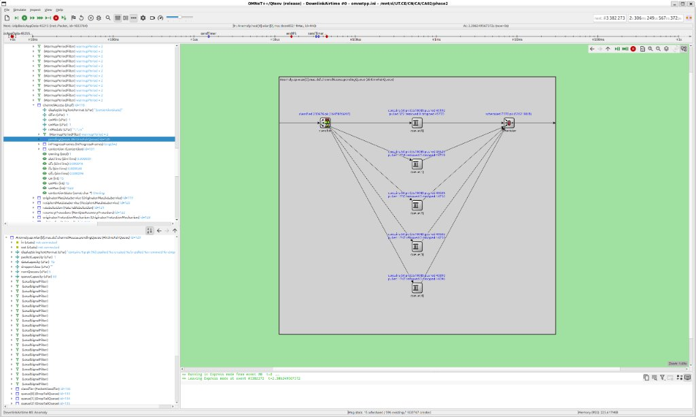
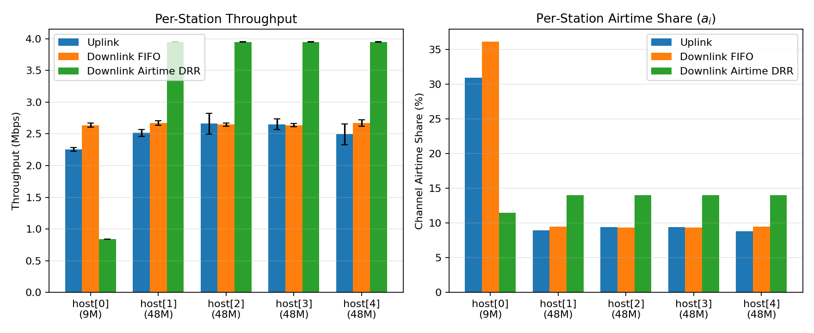

<docheader title="گزارش فاز دوم: ناهنجاری کارایی و انصاف در زمان استفاده از کانال" subtitle="درس شبکه‌های کامپیوتری — تمرین کامپیوتری شمارهٔ ۲" subtitle2="دانشگاه تهران — شماره‌های دانشجویی: ۸۱۰۱۰۲۴۴۱ و ۸۱۰۱۰۲۴۴۲"></docheader>

## پارامترهای اختصاصی گروه {#sec-p2-params}

مقادیر اختصاصی گروه برای فاز دوم بر اساس شماره‌های دانشجویی `810102441` و `810102442` توسط اسکریپت `ca2_params.py` تولید شده و در <ref to="tbl-p2-params"></ref> آمده است.

{caption="پارامترهای اختصاصی گروه در فاز دوم" #tbl-p2-params}
| پارامتر | مقدار | توضیح |
| :---: | :---: | :--- |
| $n_2$ | $5$ | تعداد ایستگاه‌ها (`host[0]` کند و `host[1..4]` سریع) |
| $L$ | $650\,\text{B}$ | اندازهٔ دادهٔ مفید هر بستهٔ UDP |
| $R_{\text{slow}}$ | $9\,\text{Mbps}$ | نرخ ارسال دادهٔ ایستگاه کند (`host[0]`) |
| $R_{\text{fast}}$ | $48\,\text{Mbps}$ | نرخ ارسال دادهٔ ایستگاه‌های سریع (`host[1..4]`) |

## جدول پیش‌بینی‌های فاز دوم {#sec-p2-predictions}

پیش‌بینی انجام‌شده پیش از نخستین اجرای زمان‌بند جدید، استدلال، نتیجهٔ واقعی اجرا و علت اختلاف در <ref to="tbl-p2-predictions"></ref> گزارش شده است.

{caption="جدول پیش‌بینی‌های فاز دوم" #tbl-p2-predictions}
| پرسش | پیش‌بینی | استدلال | نتیجهٔ اجرا | علت اختلاف |
| :--- | :--- | :--- | :--- | :--- |
| پرسش ۴-۴ (گذردهی `DownlinkAirtime`) | $S_0 \approx 0.8480\,\text{Mbps}$ برای ایستگاه کند، $S_{1..4} \approx 3.9493\,\text{Mbps}$ برای هر ایستگاه سریع و $S_{\text{tot}} \approx 16.6453\,\text{Mbps}$. | زمان‌بند Airtime DRR مجموع `headAirtime` یعنی $T_{\text{DATA}, i}$ را برای همهٔ صف‌های پر برابر می‌کند؛ بنابراین تعداد فریم‌های ارسالی هر ایستگاه با $1/T_{\text{DATA}, i}$ متناسب است و از تقسیم بودجهٔ زمان کانال، $S_i = \frac{8L / T_{\text{DATA}, i}}{\sum_j T_{\text{exch}, j}/T_{\text{DATA}, j}}$ به دست می‌آید. | $S_0 = 0.8378 \pm 0.0008\,\text{Mbps}$، $S_{1..4} \approx 3.9497\,\text{Mbps}$ و $S_{\text{tot}} = 16.6367 \pm 0.0194\,\text{Mbps}$. | اختلاف برای ایستگاه‌های سریع تنها `0.01%` و برای ایستگاه کند `1.20%` است که ناشی از گسسته‌بودن `quantum = 500 us` و تفاوت جزئی میانگین backoff در شبیه‌سازی با مقدار نظری $\frac{CW_{\min}}{2}\sigma$ است. |

## ناهنجاری در مسیر بالارونده و پایین‌رونده {#sec-p2-anomaly}

### سرآیندها و مدت ارسال داده و ACK {#sec-p2-q4-1}

**پاسخ سؤال ۴-۱:** در این سناریو ترافیک از لایه‌های UDP و IP عبور می‌کند. سرآیندهای افزوده‌شده به $L = 650\,\text{B}$ دادهٔ کاربردی (`UdpBasicApp`) عبارت‌اند از:

- دادهٔ کاربردی (UDP payload): برابر $L = 650\,\text{B}$
- سرآیند لایهٔ انتقال (`UdpHeader`): برابر $8\,\text{B}$
- سرآیند لایهٔ شبکه (`Ipv4Header`): برابر $20\,\text{B}$
- سرآیند لایهٔ پیوند/تطبیق (`Ieee802EpdHeader`): برابر $2\,\text{B}$
- سرآیند و دنبالهٔ لایهٔ MAC (`Ieee80211DataHeader` و `FCS`): برابر $24 + 4 = 28\,\text{B}$
- **اندازهٔ کل MPDU (فریم دادهٔ MAC):** $B_{\text{DATA}} = 650 + 8 + 20 + 2 + 28 = 708\,\text{B}$
- **اندازهٔ فریم ACK:** برابر $B_{\text{ACK}} = 10 + 4 = 14\,\text{B}$

با توجه به نرخ‌های اجباری استاندارد 802.11a ($6, 12, 24\,\text{Mbps}$) و رابطهٔ $T_{\text{PPDU}}(B, r) = 20\,\mu\text{s} + 4\,\mu\text{s} \cdot \left\lceil \frac{16 + 8B + 6}{4r} \right\rceil$:

- **ایستگاه کند (`host[0]`):** نرخ داده $R_{\text{slow}} = 9\,\text{Mbps}$ و نرخ ACK برابر بزرگ‌ترین نرخ اجباری کوچک‌تر یا مساوی آن یعنی $R_{\text{ACK, slow}} = 6\,\text{Mbps}$ است:

$$
T_{\text{DATA, slow}} = 20 + 4\left\lceil \frac{16 + 8(708) + 6}{36} \right\rceil = 20 + 4(158) = 652\,\mu\text{s}, \qquad T_{\text{ACK, slow}} = 20 + 4\left\lceil \frac{16 + 8(14) + 6}{24} \right\rceil = 20 + 4(6) = 44\,\mu\text{s}
$$

- **ایستگاه سریع (`host[1..4]`):** نرخ داده $R_{\text{fast}} = 48\,\text{Mbps}$ و نرخ ACK برابر $R_{\text{ACK, fast}} = 24\,\text{Mbps}$ است:

$$
T_{\text{DATA, fast}} = 20 + 4\left\lceil \frac{16 + 8(708) + 6}{192} \right\rceil = 20 + 4(30) = 140\,\mu\text{s}, \qquad T_{\text{ACK, fast}} = 20 + 4\left\lceil \frac{16 + 8(14) + 6}{96} \right\rceil = 20 + 4(2) = 28\,\mu\text{s}
$$

### نتایج شبیه‌سازی Uplink و DownlinkFifo {#sec-p2-q4-2}

**پاسخ سؤال ۴-۲:** نتایج ۵ تکرار شبیه‌سازی برای پیکربندی‌های `Uplink` و `DownlinkFifo` در <ref to="tbl-p2-up-fifo"></ref> گزارش شده است.

{caption="مقایسهٔ گذردهی، سهم زمان کانال و شاخص‌های انصاف در پیکربندی‌های Uplink و DownlinkFifo (۵ تکرار)" #tbl-p2-up-fifo}
| پیکربندی | ایستگاه | گذردهی $S_i$ ($\text{Mbps}$) | سهم زمان کانال $a_i$ ($\%$) |
| :--- | :--- | :---: | :---: |
| `Uplink` | `host[0]` ($9\,\text{Mbps}$) | $2.2561 \pm 0.0317$ | $30.89\% \pm 0.43\%$ |
| `Uplink` | `host[1]` ($48\,\text{Mbps}$) | $2.5154 \pm 0.0556$ | $8.90\% \pm 0.20\%$ |
| `Uplink` | `host[2]` ($48\,\text{Mbps}$) | $2.6603 \pm 0.1669$ | $9.41\% \pm 0.59\%$ |
| `Uplink` | `host[3]` ($48\,\text{Mbps}$) | $2.6521 \pm 0.0820$ | $9.38\% \pm 0.29\%$ |
| `Uplink` | `host[4]` ($48\,\text{Mbps}$) | $2.4930 \pm 0.1643$ | $8.82\% \pm 0.58\%$ |
| `Uplink` (جمع و انصاف) | کل شبکه | $12.5769 \pm 0.1069$ | $J(S) = 0.9956 \pm 0.0013$، $J(a) = 0.7054 \pm 0.0094$ |
| `DownlinkFifo` | `host[0]` ($9\,\text{Mbps}$) | $2.6370 \pm 0.0309$ | $36.11\% \pm 0.42\%$ |
| `DownlinkFifo` | `host[1]` ($48\,\text{Mbps}$) | $2.6716 \pm 0.0396$ | $9.45\% \pm 0.14\%$ |
| `DownlinkFifo` | `host[2]` ($48\,\text{Mbps}$) | $2.6467 \pm 0.0241$ | $9.37\% \pm 0.09\%$ |
| `DownlinkFifo` | `host[3]` ($48\,\text{Mbps}$) | $2.6374 \pm 0.0240$ | $9.33\% \pm 0.09\%$ |
| `DownlinkFifo` | `host[4]` ($48\,\text{Mbps}$) | $2.6706 \pm 0.0525$ | $9.45\% \pm 0.19\%$ |
| `DownlinkFifo` (جمع و انصاف) | کل شبکه | $13.2633 \pm 0.0488$ | $J(S) = 0.9999 \pm 0.0001$، $J(a) = 0.6557 \pm 0.0075$ |

- **علت برابری گذردهی و نابرابری سهم زمان کانال:** در `Uplink` مکانیزم DCF به هر ایستگاه فرصت برابری برای ارسال یک فریم می‌دهد و در `DownlinkFifo` صف مشترک FIFO با نرخ ورودی یکسان، تعداد برابری فریم به هر ایستگاه ارسال می‌کند. از آنجا که اندازهٔ دادهٔ همهٔ فریم‌ها یکسان ($L = 650\,\text{B}$) است، گذردهی همهٔ ایستگاه‌ها تقریباً برابر می‌شود ($J(S) \approx 1$). با این حال، زمان کانال مصرف‌شده برای هر فریم ایستگاه کند حدود $3.86$ برابر فریم ایستگاه سریع است ($712\,\mu\text{s}$ در برابر $184\,\mu\text{s}$ برای داده و SIFS و ACK)؛ در نتیجه ایستگاه کند بخش عمدهٔ زمان کانال را اشغال کرده و شاخص انصاف زمان کانال ($J(a)$) کاهش می‌یابد.
- **سهم ایستگاه کند در `DownlinkFifo`:** از کل زمان اندازه‌گیری، **`36.11%`** صرف فریم‌های `host[0]` می‌شود (که حدود `49.0%` از کل زمان اشغال مفید کانال است).

### مدل تحلیلی DownlinkFifo و اثر ایستگاه کند {#sec-p2-q4-3}

**پاسخ سؤال ۴-۳:** در `DownlinkFifo` تنها نقطهٔ دسترسی (AP) فریم داده ارسال می‌کند و ایستگاه‌ها فقط پس از SIFS، فریم ACK می‌فرستند؛ بنابراین هیچ رقابت هم‌زمان برای ارسال داده و در نتیجه هیچ برخوردی رخ نمی‌دهد و پنجرهٔ رقابت همواره روی $CW_{\min} = 15$ باقی می‌ماند.

متوسط زمان تبادل یک فریم برای ایستگاه $j$ برابر است با $T_{\text{exch}, j} = \text{DIFS} + \frac{CW_{\min}}{2}\sigma + T_{\text{DATA}, j} + \text{SIFS} + T_{\text{ACK}, j}$. با مقادیر $\text{DIFS} = 34\,\mu\text{s}$، $\frac{CW_{\min}}{2}\sigma = 7.5 \times 9 = 67.5\,\mu\text{s}$ و $\text{SIFS} = 16\,\mu\text{s}$ داریم:

- $T_{\text{exch, slow}} = 34 + 67.5 + 652 + 16 + 44 = 813.5\,\mu\text{s}$
- $T_{\text{exch, fast}} = 34 + 67.5 + 140 + 16 + 28 = 285.5\,\mu\text{s}$

در صف FIFO با بار ورودی برابر، در هر چرخه به‌طور میانگین به هر ایستگاه یک فریم ($8L$ بیت) در کل زمان $\sum_j T_{\text{exch}, j}$ تحویل داده می‌شود؛ پس:

$$
S = \frac{8L}{\sum_j \left(\text{DIFS} + \frac{CW_{\min}}{2}\sigma + T_{\text{DATA}, j} + \text{SIFS} + T_{\text{ACK}, j}\right)}
$$

- **با حضور ایستگاه کند ($1$ کند و $4$ سریع):**

$$
S_{\text{with slow}} = \frac{8 \times 650}{813.5 + 4 \times 285.5} = \frac{5200}{1955.5} = \mathbf{2.6592\,\text{Mbps}} \quad (S_{\text{tot}} = 13.2958\,\text{Mbps})
$$

که با میانگین شبیه‌سازی (`2.6566 Mbps` برای سریع‌ها و `13.2633 Mbps` کل) کمتر از $0.25\%$ اختلاف دارد.

- **بدون ایستگاه کند (فقط $4$ ایستگاه سریع):**

$$
S_{\text{without slow}} = \frac{5200}{4 \times 285.5} = \frac{5200}{1142.0} = \mathbf{4.5534\,\text{Mbps}}
$$

- **درصد کاهش گذردهی ایستگاه‌های سریع به‌دلیل حضور ایستگاه کند:**

$$
\frac{4.5534 - 2.6592}{4.5534} \times 100\% = \mathbf{41.60\%}
$$

## پیاده‌سازی زمان‌بند منصفانه استفاده از کانال {#sec-p2-drr}

### مدل تحلیلی DownlinkAirtime (پیش‌بینی پیش از اجرا) {#sec-p2-q4-4}

**پاسخ سؤال ۴-۴:** اگر مجموع هزینهٔ `headAirtime` منظور شده برای همهٔ ایستگاه‌ها برابر با ثابت $C$ شود، تعداد فریم‌های ارسالی ایستگاه $i$ برابر $N_i = C / T_{\text{DATA}, i}$ خواهد بود. از جمع کل زمان‌های تبادل در بازهٔ اندازه‌گیری $T$ داریم:

$$
T = \sum_{j=0}^{n-1} N_j \, T_{\text{exch}, j} = C \sum_{j=0}^{n-1} \frac{T_{\text{exch}, j}}{T_{\text{DATA}, j}} \implies C = \frac{T}{\sum_{j=0}^{n-1} \frac{T_{\text{exch}, j}}{T_{\text{DATA}, j}}}
$$

بنابراین گذردهی تحلیلی هر ایستگاه برابر است با:

$$
S_i = \frac{8L \cdot N_i}{T} = \frac{8L / T_{\text{DATA}, i}}{\sum_{j=0}^{n-1} \frac{\text{DIFS} + \frac{CW_{\min}}{2}\sigma + T_{\text{DATA}, j} + \text{SIFS} + T_{\text{ACK}, j}}{T_{\text{DATA}, j}}}
$$

با جایگذاری مقادیر گروه، مخرج برابر $\frac{813.5}{652} + 4 \times \frac{285.5}{140} = 1.2477 + 8.1571 = 9.4048$ است؛ در نتیجه:

- $S_0 = \frac{5200 / 652}{9.4048} = \mathbf{0.8480\,\text{Mbps}}$
- $S_{1..4} = \frac{5200 / 140}{9.4048} = \mathbf{3.9493\,\text{Mbps}}$
- $S_{\text{tot}} = 0.8480 + 4 \times 3.9493 = \mathbf{16.6453\,\text{Mbps}}$

### نتایج پیاده‌سازی و شبیه‌سازی DownlinkAirtime {#sec-p2-q4-5}

**پاسخ سؤال ۴-۵:** زمان‌بند Airtime DRR در فایل `AirtimeDrrScheduler.cc` پیاده‌سازی و پیکربندی `DownlinkAirtime` پنج بار اجرا شد. نمای داخلی صف‌های جداگانه در `Qtenv` در <ref to="fig-p2-queue"></ref>، مقایسهٔ نتایج شبیه‌سازی و مدل در <ref to="tbl-p2-airtime"></ref> و مقایسهٔ گرافیکی هر سه سناریو در <ref to="fig-p2-compare"></ref> آمده است.

<fig id="fig-p2-queue" align="center" width="90%">

<caption>نمای داخلی ماژول pendingQueue در Qtenv هنگام اجرای DownlinkAirtime شامل classifier، صف‌های جداگانهٔ ایستگاه‌ها و scheduler.</caption>
</fig>

{caption="مقایسهٔ نتایج شبیه‌سازی DownlinkAirtime (۵ تکرار) با مدل تحلیلی و سهم زمان کانال" #tbl-p2-airtime}
| ایستگاه | شبیه‌سازی ($\text{Mbps}$) | مدل تحلیلی ($\text{Mbps}$) | خطای نسبی ($\%$) | سهم زمان کانال $a_i$ ($\%$) |
| :--- | :---: | :---: | :---: | :---: |
| `host[0]` ($9\,\text{Mbps}$) | $0.8378 \pm 0.0008$ | $0.8480$ | $1.20\%$ | $11.47\%$ |
| `host[1]` ($48\,\text{Mbps}$) | $3.9499 \pm 0.0051$ | $3.9493$ | $0.01\%$ | $13.98\%$ |
| `host[2]` ($48\,\text{Mbps}$) | $3.9496 \pm 0.0047$ | $3.9493$ | $0.01\%$ | $13.98\%$ |
| `host[3]` ($48\,\text{Mbps}$) | $3.9494 \pm 0.0045$ | $3.9493$ | $0.00\%$ | $13.97\%$ |
| `host[4]` ($48\,\text{Mbps}$) | $3.9499 \pm 0.0045$ | $3.9493$ | $0.01\%$ | $13.98\%$ |
| کل و انصاف | **$16.6367 \pm 0.0194$** | **$16.6453$** | **$0.05\%$** | $J(S) = 0.8772$، **$J(a) = 0.9945$** |

<fig id="fig-p2-compare" align="center" width="100%">

<caption>مقایسهٔ گذردهی و سهم زمان کانال هر ایستگاه در سناریوهای Uplink، DownlinkFifo و DownlinkAirtime.</caption>
</fig>

- **مقایسه با `DownlinkFifo`:** گذردهی کل **`+25.43%`** افزایش یافته (`13.2633` به `16.6367 Mbps`) و گذردهی ایستگاه کند **`68.23%`** کاهش یافته است (`2.6370` به `0.8378 Mbps`).
- **چرا شاخص Jain محاسبه‌شده برای $a_i$ دقیقاً برابر یک نمی‌شود؟** تابع `headAirtime(i)` فقط مدت ارسال فریم داده ($T_{\text{DATA}, i}$) را به عنوان هزینه کسر می‌کند و زمان ثابت هر فریم شامل `SIFS + T_ACK` را که در فرمول $a_i$ شمرده می‌شود لحاظ نمی‌کند. از آنجا که ایستگاه‌های سریع در بازهٔ یکسان حدود $4.7$ برابر بیشتر از ایستگاه کند فریم می‌فرستند، سهم $a_i$ آن‌ها به‌سبب تکرار بیشتر `SIFS + T_ACK` اندکی بالاتر می‌رود (`13.98%` در برابر `11.47%`) و به همین دلیل $J(a) = 0.9945 < 1$ می‌شود.

### شرح و ردیابی دستی تابع schedulePacket {#sec-p2-q4-6}

**پاسخ سؤال ۴-۶:** تابع `schedulePacket()` ابتدا بررسی می‌کند آیا دست‌کم یک صف غیرخالی وجود دارد یا نه؛ در نبود هیچ فریم، مقدار `-1` برمی‌گرداند. سپس از اندیس `current` در حلقه پیمایش می‌کند: اگر صف `current` خالی باشد، `deficit[current]` را صفر کرده و به صف بعدی می‌رود تا ایستگاه بیکار اعتبار ذخیره نکند؛ اگر صف غیرخالی باشد ولی `deficit[current] <= 0` باشد، یک `quantum` ($500\,\mu\text{s}$) به اعتبار آن افزوده و `current` را به صف بعد می‌برد؛ و هنگامی که `deficit[current] > 0` باشد، مقدار `headAirtime(current)` را از کسری آن کم کرده و اندیس `current` را برای خدمت‌دهی برمی‌گرداند.

ردیابی دستی **ده تصمیم نخست** برای دو ایستگاه (`host[0]` کند با $T_{\text{DATA}} = 652\,\mu\text{s}$ و `host[1]` سریع با $T_{\text{DATA}} = 140\,\mu\text{s}$) و `quantum = 500 us` از حالت اولیهٔ `deficit = [0, 0]` و `current = 0` در <ref to="tbl-p2-trace"></ref> آمده است.

{caption="ردیابی دستی ده تصمیم نخست زمان‌بند Airtime DRR برای یک ایستگاه کند و یک ایستگاه سریع" #tbl-p2-trace}
| تصمیم | صف انتخاب‌شده | کسری پیش از ارسال (`[host[0], host[1]]`) ($\mu\text{s}$) | هزینه ($\mu\text{s}$) | کسری پس از ارسال (`[host[0], host[1]]`) ($\mu\text{s}$) |
| :---: | :---: | :---: | :---: | :---: |
| ۱ | `host[0]` (کند) | `[500.0, 500.0]` | $652$ | `[-152.0, 500.0]` |
| ۲ | `host[1]` (سریع) | `[348.0, 500.0]` | $140$ | `[348.0, 360.0]` |
| ۳ | `host[1]` (سریع) | `[348.0, 360.0]` | $140$ | `[348.0, 220.0]` |
| ۴ | `host[1]` (سریع) | `[348.0, 220.0]` | $140$ | `[348.0, 80.0]` |
| ۵ | `host[1]` (سریع) | `[348.0, 80.0]` | $140$ | `[348.0, -60.0]` |
| ۶ | `host[0]` (کند) | `[348.0, 440.0]` | $652$ | `[-304.0, 440.0]` |
| ۷ | `host[1]` (سریع) | `[196.0, 440.0]` | $140$ | `[196.0, 300.0]` |
| ۸ | `host[1]` (سریع) | `[196.0, 300.0]` | $140$ | `[196.0, 160.0]` |
| ۹ | `host[1]` (سریع) | `[196.0, 160.0]` | $140$ | `[196.0, 20.0]` |
| ۱۰ | `host[1]` (سریع) | `[196.0, 20.0]` | $140$ | `[196.0, -120.0]` |

## تحلیل و محدودیت‌ها {#sec-p2-limits}

### تحلیل تأخیر انتهابه‌انتها با قانون Little {#sec-p2-q4-7}

**پاسخ سؤال ۴-۷:** در حالت اشباع صف‌ها همواره پرند: در `DownlinkFifo` صف مشترک با ظرفیت $100$ فریم به‌طور متوسط میان $5$ ایستگاه تقسیم می‌شود ($Q_i = 20$ فریم) و در `DownlinkAirtime` هر ایستگاه صف اختصاصی با ظرفیت $Q_i = 50$ فریم دارد. با استفاده از قانون Little ($W_i = Q_i / \lambda_i$ که $\lambda_i = S_i / (8L)$)، پیش‌بینی نظری و مقدار شبیه‌سازی `endToEndDelay` در <ref to="tbl-p2-delay"></ref> مقایسه شده‌اند.

{caption="مقایسهٔ پیش‌بینی قانون Little با میانگین تأخیر انتهابه‌انتهای شبیه‌سازی" #tbl-p2-delay}
| پیکربندی | ایستگاه | پیش‌بینی قانون Little ($\text{ms}$) | میانگین شبیه‌سازی `endToEndDelay` ($\text{ms}$) |
| :--- | :--- | :---: | :---: |
| `DownlinkFifo` | `host[0]` (کند) | $39.44$ | $40.26 \pm 0.14$ |
| `DownlinkFifo` | `host[1]` (سریع) | $38.93$ | $39.76 \pm 0.16$ |
| `DownlinkAirtime` | `host[0]` (کند) | $310.33$ | $311.22 \pm 0.35$ |
| `DownlinkAirtime` | `host[1]` (سریع) | $65.82$ | $66.23 \pm 0.08$ |

**چرا زمان‌بند منصفانه تأخیر ایستگاه کند را تا این حد افزایش می‌دهد؟** دو عامل هم‌زمان اثر می‌گذارند: نخست آنکه طول صف ایستگاه کند در `AirtimeFairQueue` برابر $50$ فریم است (در برابر حدود $20$ فریم سهم آن در صف مشترک FIFO، یعنی $2.5$ برابر بیشتر)، و دوم آنکه نرخ سرویس‌دهی ($\lambda_0$) به ایستگاه کند از $2.637\,\text{Mbps}$ به $0.838\,\text{Mbps}$ (حدود $3.15$ برابر کمتر) کاهش می‌یابد؛ ترکیب این دو عامل تأخیر صف‌بندی را حدود $7.8$ برابر کرده و به $\sim 311\,\text{ms}$ می‌رساند.

### رفتار با بار ورودی کم برای ایستگاه کند {#sec-p2-q4-8}

**پاسخ سؤال ۴-۸:** در پیکربندی‌های `DownlinkFifoLowLoad` و `DownlinkAirtimeLowLoad` فاصلهٔ ارسال `server.app[0]` برابر `exponential(25ms)` تنظیم شد (میانگین بار درخواستی $8 \times 650 / 0.025 = 0.2080\,\text{Mbps}$). نتایج ۵ تکرار در <ref to="tbl-p2-lowload"></ref> و <ref to="fig-p2-lowload"></ref> آمده است.

{caption="مقایسهٔ FIFO و Airtime DRR هنگامی که ایستگاه کند بار ورودی کمی دارد (۵ تکرار)" #tbl-p2-lowload}
| ایستگاه | `DownlinkFifoLowLoad` ($S_i$ / تأخیر) | `DownlinkAirtimeLowLoad` ($S_i$ / تأخیر) |
| :--- | :---: | :---: |
| `host[0]` ($9\,\text{Mbps}$) | $0.0088 \pm 0.0032\,\text{Mbps}$ / $29.57 \pm 0.15\,\text{ms}$ | **$0.2142 \pm 0.0120\,\text{Mbps}$ / $7.77 \pm 0.13\,\text{ms}$** |
| `host[1..4]` (میانگین هر سریع) | $4.5447\,\text{Mbps}$ / $29.01\,\text{ms}$ | $4.3973\,\text{Mbps}$ / $59.52\,\text{ms}$ |
| کل شبکه | $18.1874 \pm 0.0316\,\text{Mbps}$ | $17.8034 \pm 0.0356\,\text{Mbps}$ |

<fig id="fig-p2-lowload" align="center" width="80%">

<caption>مقایسهٔ گذردهی ایستگاه‌ها در حالت کم‌بار ایستگاه کند بین FIFO و Airtime DRR.</caption>
</fig>

- در **FIFO**، چهار ایستگاه سریع با بار اشباع (`50 us`) پیوسته صف مشترک $100$ فریمی را پر نگه می‌دارند و بیشتر بسته‌های `host[0]` در ورود به صف دور ریخته می‌شوند؛ بنابراین ایستگاه کند دچار گرسنگی شدید شده و تنها $0.0088\,\text{Mbps}$ (حدود $4\%$ بار درخواستی) را دریافت می‌کند. در مقابل، با **Airtime DRR**، ایستگاه کند صف اختصاصی دارد و تمام بار درخواستی خود ($0.2142 \approx 0.2080\,\text{Mbps}$) را با تأخیر بسیار کمتر ($7.77\,\text{ms}$ در برابر $29.57\,\text{ms}$) دریافت می‌کند.
- **چرا تخصیص منصفانهٔ زمان کانال، خدمت‌دهی به ایستگاه کم‌بار را محدود نمی‌کند؟** زیرا ایستگاه کند در این حالت کمتر از سهم منصفانهٔ $20\%$ خود زمان نیاز دارد؛ هر زمان بسته‌ای به صف آن برسد در نخستین دور زمان‌بندی ارسال می‌شود و به محض خالی شدن صفش، اعتبار اضافهٔ آن صفر شده و تمامی زمان باقی‌ماندهٔ کانال در اختیار ایستگاه‌های سریع قرار می‌گیرد.

### محدودیت در مسیر بالارونده {#sec-p2-q4-9}

**پاسخ سؤال ۴-۹:** **خیر.** زمان‌بند صف AP تنها ترتیب خروج فریم‌های مسیر **پایین‌رونده (Downlink)** از بافر خود AP را کنترل می‌کند. در مسیر **بالارونده (Uplink)**، تصمیم زمان‌بندی و رقابت دسترسی به کانال به شکل توزیع‌شده توسط خود ایستگاه‌ها (در لایهٔ MAC هر ایستگاه با الگوریتم DCF) انجام می‌شود؛ از این رو AP نمی‌تواند تعداد دفعات ارسال ایستگاه کند در مسیر بالارونده را با صف‌بندی داخلی خود محدود کند.
