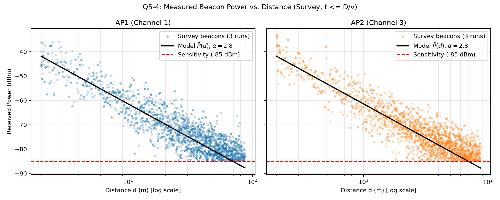
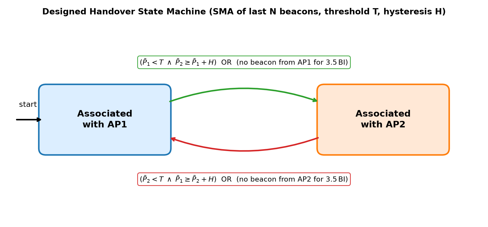
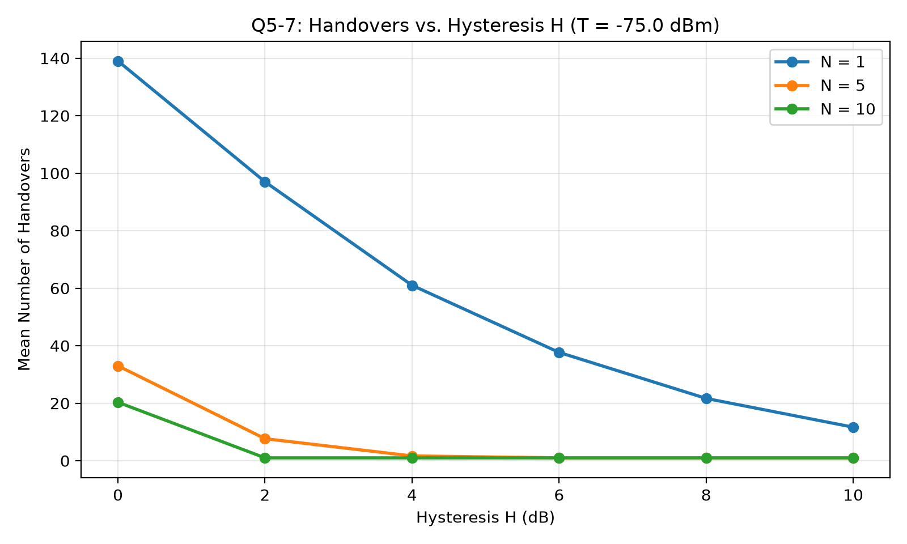

<docheader title="گزارش فاز سوم: جابه‌جایی بین APها و ایستگاه چسبنده" subtitle="درس شبکه‌های کامپیوتری — تمرین کامپیوتری شمارهٔ ۲" subtitle2="دانشگاه تهران — شماره‌های دانشجویی: ۸۱۰۱۰۲۴۴۱ و ۸۱۰۱۰۲۴۴۲"></docheader>

## پارامترهای اختصاصی گروه {#sec-p3-params}

مقادیر اختصاصی گروه برای فاز سوم بر اساس شماره‌های دانشجویی `810102441` و `810102442` در <ref to="tbl-p3-params"></ref> آمده است.

{caption="پارامترهای اختصاصی گروه در فاز سوم" #tbl-p3-params}
| پارامتر | مقدار | توضیح |
| :---: | :---: | :--- |
| $\alpha$ | $2.8$ | نمای اتلاف مسیر |
| $\sigma$ | $5\,\text{dB}$ | انحراف معیار سایه‌افکنی لگاریتمی نرمال |
| $v$ | $1.25\,\text{m/s}$ | سرعت حرکت ایستگاه |
| $\text{BI}$ | $100\,\text{ms}$ | فاصلهٔ ارسال beacon در هر دو AP |
| $n_{\text{ch}}$ | $8$ | تعداد کانال‌های پویش ($0$ تا $7$) |
| $D$ | $87\,\text{m}$ | فاصلهٔ بین دو AP (مدت حرکت: $T_{\text{walk}} = D/v = 69.6\,\text{s}$) |

## جدول پیش‌بینی‌های فاز سوم {#sec-p3-predictions}

پیش‌بینی‌های انجام‌شده پیش از اجرای آزمایش‌ها و مقایسهٔ آن‌ها با نتایج واقعی در <ref to="tbl-p3-predictions"></ref> گزارش شده است.

{caption="جدول پیش‌بینی‌های فاز سوم" #tbl-p3-predictions}
| پرسش | پیش‌بینی | استدلال | نتیجهٔ اجرا | علت اختلاف |
| :--- | :--- | :--- | :--- | :--- |
| پرسش ۵-۳ (`ScanNeighbor`) | مدت قطعی در `ScanNeighbor` حدود **$0.65\,\text{s}$ تا $0.80\,\text{s}$** خواهد بود (بسیار کمتر از `Walk` با حدود $2.15$ تا $2.30\,\text{s}$). | با محدود کردن `channelsToScan` به `"1 3"`، به‌جای پویش ۸ کانال فقط ۲ کانال پویش می‌شوند؛ با `probeDelay = 100ms`، `minChannelTime = 150ms` و `maxChannelTime = 300ms`، اگر هر دو کانال فعال تشخیص داده شوند پویش $2 \times (100+300) = 800\,\text{ms}$ و اگر فقط کانال ۳ فعال باشد $650\,\text{ms}$ طول می‌کشد. | میانگین مدت قطعی در ۵ تکرار `ScanNeighbor` برابر **$0.8195 \pm 0.0010\,\text{s}$** شد (کاهش ۶۶ درصدی نسبت به `Walk` با $2.4119 \pm 0.1048\,\text{s}$). | پیش‌بینی کاملاً درست بود؛ اختلاف جزئی (حدود ۲۰ میلی‌ثانیه) ناشی از زمان احراز هویت، برقراری ارتباط و فاصلهٔ زمانی تا ارسال نخستین فریم صوتی بعدی (هر $20\,\text{ms}$) است. |
| پرسش ۵-۶ الف ($H=0, N=1$) | بدون هموارسازی ($N=1$) و بدون هیسترزیس ($H=0$)، در میانهٔ مسیر تعداد **زیادی جابه‌جایی رفت‌وبرگشتی** (چند ده تا بیش از صد جابه‌جایی) رخ می‌دهد. | چون $\sigma = 5\,\text{dB}$ زیاد است، در بازه‌ای که میانگین توان دو AP نزدیک به هم است، هر beacon منفرد با افت یا جهش تصادفی نوسان می‌کند و باعث جابه‌جایی مداوم بین `ap1` و `ap2` می‌شود. | میانگین تعداد جابه‌جایی در ۳ اجرای `Survey` برابر **$139.00$** (مقادیر `[143, 133, 141]`) شد. | پیش‌بینی درست بود؛ نبود هموارسازی و هیسترزیس باعث نوسان شدید رفت‌وبرگشتی (Ping-pong) در میانهٔ مسیر شد. |
| پرسش ۵-۶ ب ($H=6\,\text{dB}$ بدون نویز) | جابه‌جایی در نقطهٔ **$x^* \approx 54.02\,\text{m}$** رخ می‌دهد. | با نادیده گرفتن فاصلهٔ ۲ متری و در نبود نویز، شرط $\bar{P}_2(x) - \bar{P}_1(x) = 10\alpha \log_{10}(x/(D-x)) \ge H$ نتیجه می‌دهد $x^* = \frac{10^{H/(10\alpha)}}{1 + 10^{H/(10\alpha)}} D$؛ برای $H=6$ و $\alpha=2.8$ مقدار $x^* = 54.02\,\text{m}$ است (که در آن $\bar{P}_1 \approx -82\,\text{dBm} < T=-75\,\text{dBm}$ نیز برقرار است). | در آزمایش روی داده‌های واقعی `Survey` (با سایه‌افکنی)، میانگین محل جابه‌جایی برای $(H=6, N=10)$ برابر $47.87\,\text{m}$ شد (`[48.20, 41.00, 54.40]`). | در داده‌های واقعی `Survey`، سایه‌افکنی $\sigma=5\,\text{dB}$ در اجراهای ۰ و ۱ باعث افت بیش از ۳ beacon متوالی زیر $-85\,\text{dBm}$ و فعال شدن تایم‌اوت $3.5\,\text{BI}$ در $48.2\,\text{m}$ و $41.0\,\text{m}$ شد؛ در اجرای ۲ که تایم‌اوت رخ نداد، هیسترزیس دقیقاً در $54.40\,\text{m}$ عمل کرد. |

## بررسی مراحل جابه‌جایی {#sec-p3-stages}

### جدول زمانی یک جابه‌جایی کامل {#sec-p3-q5-1}

**پاسخ سؤال ۵-۱:** جدول زمانی کامل جابه‌جایی برای اجرای `Walk-#0` (استخراج‌شده از فایل `Walk-#0.vec`) و تناظر هر رویداد با گذارهای شکل ۷ صورت تمرین در <ref to="tbl-p3-timeline"></ref> آمده است.

{caption="جدول زمانی کامل جابه‌جایی در اجرای Walk-#0 و تناظر با گذارهای نمودار حالت" #tbl-p3-timeline}
| رویداد | زمان ($\text{s}$) | جزئیات و مقدار | گذار متناظر در شکل ۷ |
| :--- | :---: | :--- | :--- |
| آخرین فریم صوتی در `ap1.sink` | `40.600467` | موقعیت $x = 50.75\,\text{m}$ | باقی ماندن در حالت `Associated` (`ap1`) |
| شروع پویش (`sentRequest = 1`) | `40.609385` | موقعیت $x = 50.76\,\text{m}$ | گذار `Associated` به `Scanning` (نبود beacon به مدت $3.5\,\text{BI}$) |
| توقف روی کانال `0` | `40.609385` | مدت توقف: `250.0 ms` (خالی) | پویش فعال در حالت `Scanning` |
| توقف روی کانال `1` | `40.859385` | مدت توقف: `400.0 ms` (فعال: `ap1`) | پویش فعال در حالت `Scanning` |
| توقف روی کانال `2` | `41.259385` | مدت توقف: `250.0 ms` (خالی) | پویش فعال در حالت `Scanning` |
| توقف روی کانال `3` | `41.509385` | مدت توقف: `400.0 ms` (فعال: `ap2`) | پویش فعال در حالت `Scanning` |
| توقف روی کانال `4` | `41.909385` | مدت توقف: `250.0 ms` (خالی) | پویش فعال در حالت `Scanning` |
| توقف روی کانال `5` | `42.159385` | مدت توقف: `250.0 ms` (خالی) | پویش فعال در حالت `Scanning` |
| توقف روی کانال `6` | `42.409385` | مدت توقف: `250.0 ms` (خالی) | پویش فعال در حالت `Scanning` |
| توقف روی کانال `7` | `42.659385` | مدت توقف: `250.0 ms` (خالی) | پویش فعال در حالت `Scanning` |
| پایان پویش (`acceptConfirm = 1`) | `42.909385` | جمع مدت پویش: `2.300 s` | گذار `Scanning` به `Authenticating` (انتخاب قوی‌ترین AP) |
| شروع و پایان احراز هویت (`req/acc = 2`) | `42.909385` تا `42.910144` | مدت: `0.759 ms` (۴ فریم) | گذار `Authenticating` به `Associating` |
| شروع و پایان برقراری ارتباط (`req/acc = 4`) | `42.910144` تا `42.910614` | مدت: `0.470 ms` (۲ فریم) | گذار `Associating` به `Associated` (`ap2`) |
| نخستین فریم صوتی در `ap2.sink` | `42.920152` | موقعیت $x = 53.65\,\text{m}$ (مدت قطعی: `2.3197 s`) | ارسال داده در حالت `Associated` (`ap2`) |

<alert type="note">

**مشاهدهٔ جزئیات پیاده‌سازی INET در تکرارهای دیگر `Walk`:** در تکرارهای `Walk-#2` و `Walk-#3`، مدت توقف روی کانال `1` برابر `500 ms` و روی کانال `2` برابر `300 ms` شده است (جمعاً $150\,\text{ms}$ بیشتر از رابطهٔ تحلیلی) که به جزئیات زمان‌بند داخلی INET مربوط است؛ همچنین در `Walk-#4` کانال `0` نیز `400 ms` طول کشیده است. به همین دلیل در آن تکرارها مدت قطعی حدود `2.46` تا `2.48` ثانیه ثبت شده است.

</alert>

### رابطهٔ مدت پویش فعال و تحلیل مدت قطعی {#sec-p3-q5-2}

**پاسخ سؤال ۵-۲:** اگر از $n_{\text{ch}}$ کانال، در $m$ کانال فعالیت رادیویی تشخیص داده شود و در $n_{\text{ch}} - m$ کانال تشخیص داده نشود، مدت یک پویش فعال از رابطهٔ زیر به دست می‌آید:

$$
T_{\text{scan}} = n_{\text{ch}} \cdot \text{probeDelay} + m \cdot \text{maxChannelTime} + (n_{\text{ch}} - m) \cdot \text{minChannelTime}
$$

با پارامترهای گروه ($n_{\text{ch}} = 8$، `probeDelay = 100ms`، `minChannelTime = 150ms` و `maxChannelTime = 300ms`)، تنها `ap1` (کانال ۱) و `ap2` (کانال ۳) در محیط حضور دارند. در لحظهٔ شروع پویش، ایستگاه هنوز در محدوده‌ای است که به‌طور متناوب سیگنال `ap1` را نیز می‌گیرد؛ بنابراین معمولاً هر دو کانال ۱ و ۳ ($m = 2$) فعال تشخیص داده می‌شوند:

- حالت هر دو کانال فعال ($m = 2$): برابر $T_{\text{scan}} = 8(100) + 2(300) + 6(150) = 800 + 600 + 900 = \mathbf{2300\,\text{ms} = 2.30\,\text{s}}$
- حالت تنها کانال ۳ فعال ($m = 1$): برابر $T_{\text{scan}} = 8(100) + 1(300) + 7(150) = \mathbf{2150\,\text{ms} = 2.15\,\text{s}}$

نتیجهٔ ۵ اجرای `Walk`:

- مقادیر مدت قطعی در ۵ تکرار: `2.3197 s`، `2.3200 s`، `2.4800 s`، `2.4797 s` و `2.4600 s`
- میانگین و بازهٔ اطمینان ۹۵٪: برابر **$2.4119 \pm 0.1048\,\text{s}$** که بسیار نزدیک به $T_{\text{scan}} = 2.30\,\text{s}$ است و اختلاف جزئی ناشی از `+150 ms` توقف اضافی INET در تکرارهای ۲ تا ۴ است.

**علت نزدیکی مدت قطعی به مدت پویش (و نه مجموع $3.5\,\text{BI}$ و مدت پویش):** در طول پنجرهٔ زمانی $3.5\,\text{BI}$ ($0.35\,\text{s}$)، ایستگاه هنوز در حالت `Associated` با `ap1` قرار دارد و رادیویش روی کانال ۱ مانده است؛ بنابراین فریم‌های صوتی $20\,\text{ms}$ای را کماکان به `ap1` ارسال می‌کند و تا آخرین لحظهٔ پیش از قطع ارتباط دریافت می‌شوند. قطعی واقعی زمانی آغاز می‌شود که زمان‌سنج $3.5\,\text{BI}$ منقضی شود و ایستگاه برای پویش کانال فعلی را ترک کند.

### محدود کردن پویش به کانال‌های همسایه {#sec-p3-q5-3}

**پاسخ سؤال ۵-۳:** پیکربندی `ScanNeighbor` در انتهای `omnetpp.ini` با ارث‌بری از `Walk` و تنظیم `*.host.wlan.agent.channelsToScan = "1 3"` اضافه و ۵ بار اجرا شد:

- مقادیر مدت قطعی در ۵ اجرا: `0.8200 s`، `0.8196 s`، `0.8181 s`، `0.8196 s` و `0.8200 s`
- میانگین و بازهٔ اطمینان ۹۵٪: برابر **$0.8195 \pm 0.0010\,\text{s}$** (دقیقاً مطابق پیش‌بینی $0.80\,\text{s}$ برای $m = 2$ به علاوهٔ حدود ۲۰ میلی‌ثانیه زمان احراز هویت، برقراری ارتباط و رسیدن نخستین بستهٔ بعدی).
- نسبت به `Walk` ($2.4119\,\text{s}$)، مدت قطعی **۶۶.۰٪ کاهش** یافته است، زیرا ۶ کانال خالی از فهرست پویش حذف شده‌اند.
- نکتهٔ جالب در اجرای `ScanNeighbor-#2`: ایستگاه یک بار در $t = 50.5686\,\text{s}$ پویش کرد ولی چون `ap1` هنوز قوی‌ترین فریم را داشت دوباره به `ap1` وصل شد و سپس در $t = 52.6686\,\text{s}$ برای بار دوم پویش کرد و در $53.4802\,\text{s}$ به `ap2` منتقل شد.

## ایستگاه چسبنده {#sec-p3-sticky}

### نمودار توان دریافتی بر حسب فاصله {#sec-p3-q5-4}

**پاسخ سؤال ۵-۴:** توان نویز از پارامتر `Roaming.radioMedium.backgroundNoise.power` در شبیه‌ساز برابر **$N = -110\,\text{dBm}$** است و توان دریافتی از رابطهٔ $P_r(\text{dBm}) = -110 + 10\log_{10}(\text{SNIR})$ محاسبه شد. نمودار پراکندگی توان دریافتی در ۳ اجرای `Survey` (برای داده‌های زمان حرکت یعنی $t \le D/v = 69.6\,\text{s}$) به همراه منحنی میانگین مدل $\bar{P}(d)$ با $\alpha = 2.8$ و خط حساسیت $-85\,\text{dBm}$ در <ref to="fig-p3-power"></ref> رسم شده است.

<fig id="fig-p3-power" align="center" width="90%">

<caption>توان دریافتی اندازه‌گیری‌شده در سه اجرای Survey بر حسب فاصله با محور افقی لگاریتمی به همراه منحنی میانگین مدل و آستانهٔ حساسیت گیرنده.</caption>
</fig>

پراکندگی نقاط اندازه‌گیری‌شده نسبت به منحنی میانگین در فاصله‌های کم و زیاد به شرح زیر است:

- **در فاصله‌های کم:** میانگین توان دریافتی بسیار بالاتر از آستانهٔ حساسیت $-85\,\text{dBm}$ است (برای نمونه در $d = 2\,\text{m}$ حدود $-41.9\,\text{dBm}$)؛ بنابراین تقریباً تمام فریم‌ها بدون افتادن به زیر آستانه دریافت می‌شوند و نقاط به‌صورت متقارن در هر دو طرف خط میانگین با انحراف معیار $\sigma = 5\,\text{dB}$ پراکنده‌اند.
- **در فاصله‌های زیاد:** خط میانگین به $-85\,\text{dBm}$ نزدیک یا از آن کمتر می‌شود؛ در نتیجه فریم‌هایی که به‌علت سایه‌افکنی منفی ($X < 0$) زیر $-85\,\text{dBm}$ قرار می‌گیرند اصلاً دریافت و ثبت نمی‌شوند (سانسور شدن از پایین یا Survivor bias). به همین دلیل نقاط ثبت‌شده عمدتاً بالای خط حساسیت $-85\,\text{dBm}$ و متمایل به بالای منحنی میانگین جمع می‌شوند.

### تحلیل تأخیر چسبندگی و قاعدهٔ زمان‌سنج {#sec-p3-q5-5}

**پاسخ سؤال ۵-۵:**

1. **نقطهٔ برابری توان میانگین دو AP (بخش آ):** به‌دلیل تقارن دو AP با توان ارسال یکسان و مسیر موازی، در میانهٔ مسیر یعنی **$x = D/2 = 43.50\,\text{m}$** (در زمان **$t = 43.50 / 1.25 = 34.80\,\text{s}$**) توان میانگین دو AP برابر است ($\bar{P}_1 = \bar{P}_2 = -79.36\,\text{dBm}$).
2. **نقطهٔ شروع پویش عامل INET و تأخیر چسبندگی (بخش ب):** در ۵ اجرای `Walk`، نقطهٔ شروع پویش (`sentRequest = 1` پس از $t > 5\,\text{s}$) به قرار زیر ثبت شد:
   - تکرار ۰: زمان $t = 40.61\,\text{s}$ و موقعیت $x = 50.76\,\text{m}$
   - تکرار ۱: زمان $t = 48.65\,\text{s}$ و موقعیت $x = 60.81\,\text{m}$
   - تکرار ۲: زمان $t = 44.57\,\text{s}$ و موقعیت $x = 55.71\,\text{m}$
   - تکرار ۳: زمان $t = 42.46\,\text{s}$ و موقعیت $x = 53.07\,\text{m}$
   - تکرار ۴: زمان $t = 41.44\,\text{s}$ و موقعیت $x = 51.80\,\text{m}$
   - میانگین و بازهٔ اطمینان ۹۵٪ نقطهٔ جابه‌جایی: **$x_{\text{ho}} = 54.43 \pm 4.99\,\text{m}$** ($t = 43.55 \pm 3.99\,\text{s}$).
   - تأخیر جابه‌جایی ناشی از چسبندگی بر حسب متر برابر $54.43 - 43.50 = \mathbf{10.93\,\text{m}}$ و بر حسب ثانیه برابر $43.55 - 34.80 = \mathbf{8.75\,\text{s}}$ است.
3. **توضیح قاعدهٔ $3.5\,\text{BI}$ (بخش ج):** فرض کنید آخرین beacon در لحظهٔ $t_0$ از `ap1` دریافت شده و زمان‌سنج $3.5\,\text{BI}$ ($350\,\text{ms}$) تنظیم شده است. پیام‌های beacon بعدی در لحظات $t_0 + \text{BI}$، $t_0 + 2\text{BI}$ و $t_0 + 3\text{BI}$ می‌رسند (و در صورت دریافت، زمان‌سنج را از نو آغاز می‌کنند). اگر این **۳** beacon متوالی به دلیل ضعف سیگنال از دست بروند، در لحظهٔ $t_0 + 3.5\,\text{BI}$ زمان‌سنج منقضی می‌شود و پیش از رسیدن beacon چهارم در $t_0 + 4\text{BI}$ ارتباط قطع‌شده اعلام می‌گردد. دلیل انتخاب $3.5\,\text{BI}$ به‌جای $3\,\text{BI}$، جلوگیری از قطع ناخواسته بر اثر خطای ساعت یا تأخیر کوچک صف و رقابت MAC هنگام دریافت beacon سوم است؛ با این حال از دست رفتن عدد صحیح **۳ beacon متوالی** برای منقضی شدن زمان‌سنج کافی است.

## طراحی الگوریتم جابه‌جایی {#sec-p3-algorithm}

### نمودار ماشین حالت و تحلیل نظری {#sec-p3-q5-6}

**پاسخ سؤال ۵-۶:** نمودار ماشین حالت طراحی‌شده در <ref to="fig-p3-fsm"></ref> ترسیم شده است. این ماشین شامل دو حالت `Associated with AP1` و `Associated with AP2` است و گذار زمانی رخ می‌دهد که یا شرط $(\bar{P}_{\text{curr}} < T \land \bar{P}_{\text{other}} \ge \bar{P}_{\text{curr}} + H)$ برقرار شود یا به مدت $3.5\,\text{BI}$ پیامی از AP فعلی دریافت نگردد.

<fig id="fig-p3-fsm" align="center" width="90%">

<caption>نمودار ماشین حالت پیشنهادی با میانگین متحرک، آستانهٔ توان، هیسترزیس و زمان‌سنج قطع ارتباط.</caption>
</fig>

تحلیل دو پیش‌بینی خواسته‌شده پیش از اجرا:

- **پیش‌بینی الف ($H=0$ و $N=1$):** به‌علت انحراف معیار بالای سایه‌افکنی ($\sigma = 5\,\text{dB}$) و نبود هموارسازی، در میانهٔ مسیر ده‌ها تا بیش از صد جابه‌جایی رفت‌وبرگشتی رخ می‌دهد.
- **پیش‌بینی ب ($H=6\,\text{dB}$ در نبود نویز):** با صرف‌نظر از فاصلهٔ عمودی ۲ متری از خط اتصال دو AP داریم:

$$
\bar{P}_2(x) - \bar{P}_1(x) = 10\alpha \log_{10}\left(\frac{x}{D - x}\right) \ge H \implies x^* = \frac{10^{H/(10\alpha)}}{1 + 10^{H/(10\alpha)}} D
$$

با جایگذاری $H = 6\,\text{dB}$، $\alpha = 2.8$ و $D = 87\,\text{m}$ به دست می‌آوریم:

$$
x^* = \frac{10^{6/28}}{1 + 10^{6/28}} \times 87 = \frac{1.6379}{2.6379} \times 87 \approx \mathbf{54.02\,\text{m}}
$$

### ارزیابی ماشین حالت روی داده‌های واقعی {#sec-p3-q5-7}

**پاسخ سؤال ۵-۷:** برای انتخاب آستانهٔ شروع بررسی جابه‌جایی مقدار **$T = -75\,\text{dBm}$** برگزیده شد. با توجه به اینکه در میانهٔ مسیر ($x = 43.5\,\text{m}$) میانگین توان هر دو AP برابر $-79.36\,\text{dBm}$ و حساسیت گیرنده $-85\,\text{dBm}$ است، انتخاب $T = -75\,\text{dBm}$ حاشیهٔ امن $10\,\text{dB}$ بالاتر از آستانهٔ قطع سیگنال ایجاد می‌کند؛ به‌طوری که در نیمهٔ نخست مسیر که سیگنال `ap1` قوی است ($\bar{P}_1 > -75\,\text{dBm}$ برای $x < 30.4\,\text{m}$) بررسی غیرضروری انجام نمی‌شود، اما پیش از رسیدن به میانهٔ مسیر بررسی جابه‌جایی فعال می‌شود.

نتایج اجرای ماشین حالت روی ۳ تکرار `Survey` برای مقادیر مختلف $N$ و $H$ در <ref to="tbl-p3-fsm"></ref> و نمودار میانگین تعداد جابه‌جایی‌ها بر حسب $H$ در <ref to="fig-p3-handovers"></ref> ارائه شده است.

{caption="نتایج اجرای ماشین حالت پیشنهادی روی سه تکرار Survey با آستانهٔ توان ۷۵- دسی‌بل‌میلی‌وات" #tbl-p3-fsm}
| $N$ | $H$ ($\text{dB}$) | تعداد جابه‌جایی در ۳ اجرا | میانگین تعداد جابه‌جایی | محل آخرین جابه‌جایی ($\text{m}$) | میانگین محل آخرین جابه‌جایی ($\text{m}$) |
| :---: | :---: | :---: | :---: | :---: | :---: |
| $1$ | $0$ | `[143, 133, 141]` | $139.00$ | `[64.82, 65.25, 70.15]` | $66.74$ |
| $1$ | $2$ | `[107, 93, 91]` | $97.00$ | `[64.82, 65.25, 69.15]` | $66.41$ |
| $1$ | $4$ | `[73, 61, 49]` | $61.00$ | `[64.82, 60.50, 69.15]` | $64.82$ |
| $1$ | $6$ | `[41, 39, 33]` | $37.67$ | `[58.94, 60.50, 69.15]` | $62.86$ |
| $1$ | $8$ | `[27, 17, 21]` | $21.67$ | `[58.94, 60.55, 69.15]` | $62.88$ |
| $1$ | $10$ | `[15, 11, 9]` | $11.67$ | `[58.94, 53.00, 52.77]` | $54.91$ |
| $5$ | $0$ | `[45, 29, 25]` | $33.00$ | `[59.32, 52.18, 52.43]` | $54.64$ |
| $5$ | $2$ | `[7, 5, 11]` | $7.67$ | `[47.69, 49.25, 52.30]` | $49.75$ |
| $5$ | $4$ | `[3, 1, 1]` | $1.67$ | `[47.69, 41.00, 45.40]` | $44.70$ |
| $5$ | $6$ | `[1, 1, 1]` | **$1.00$** | `[48.20, 41.00, 45.68]` | $44.96$ |
| $5$ | $8$ | `[1, 1, 1]` | **$1.00$** | `[48.20, 41.00, 54.40]` | $47.87$ |
| $5$ | $10$ | `[1, 1, 1]` | **$1.00$** | `[48.20, 41.00, 56.90]` | $48.70$ |
| $10$ | $0$ | `[29, 11, 21]` | $20.33$ | `[48.20, 48.93, 52.52]` | $49.88$ |
| $10$ | $2$ | `[1, 1, 1]` | **$1.00$** | `[48.20, 41.00, 45.27]` | $44.82$ |
| $10$ | $4$ | `[1, 1, 1]` | **$1.00$** | `[48.20, 41.00, 48.30]` | $45.83$ |
| $10$ | $6$ | `[1, 1, 1]` | **$1.00$** | `[48.20, 41.00, 54.40]` | $47.87$ |
| $10$ | $8$ | `[1, 1, 1]` | **$1.00$** | `[48.20, 41.00, 56.90]` | $48.70$ |
| $10$ | $10$ | `[1, 1, 1]` | **$1.00$** | `[48.20, 41.00, 56.90]` | $48.70$ |

<fig id="fig-p3-handovers" align="center" width="85%">

<caption>میانگین تعداد جابه‌جایی‌ها بر حسب هیسترزیس برای اندازه‌های مختلف پنجرهٔ میانگین متحرک.</caption>
</fig>

جمع‌بندی تحلیل رفتار الگوریتم:

- **ناحیهٔ وقوع جابه‌جایی‌های رفت‌وبرگشتی (Ping-pong) و علت آن:** این جابه‌جایی‌ها در **میانهٔ مسیر** (اطراف $x = D/2 = 43.5\,\text{m}$، تقریباً از $30$ تا $60\,\text{m}$) رخ می‌دهند؛ زیرا در این ناحیه اختلاف توان میانگین دو AP کوچک‌تر از دامنهٔ نوسانات سایه‌افکنی ($\sigma = 5\,\text{dB}$) است و با نوسان تصادفی فریم‌ها جهت برتری توان پیوسته تغییر می‌کند.
- **پیشنهاد ترکیب بهینهٔ $(H, N)$ با دقیقاً یک جابه‌جایی در هر سه اجرا:** ترکیب **$N = 10$ و $H = 2\,\text{dB}$** (یا **$N = 5$ و $H = 6\,\text{dB}$**) در هر سه اجرا دقیقاً یک جابه‌جایی ایجاد می‌کند و محل میانگین جابه‌جایی آن **$44.82\,\text{m}$** (یا $44.96\,\text{m}$) است که بسیار نزدیک به نقطهٔ ایدئال میانهٔ مسیر ($43.50\,\text{m}$) بوده و حدود **$9.6\,\text{m}$ زودتر** از عامل چسبندهٔ INET ($54.43\,\text{m}$) جابه‌جا می‌شود.
- **پیامد نامطلوب بزرگ کردن بیش از حد $H$ و $N$:** بزرگ کردن زیاد **$H$** موجب **چسبندگی دوباره** می‌شود؛ یعنی ایستگاه بیش از حد منتظر اختلاف توان زیاد می‌ماند و پس از نقطهٔ برابری نیز به AP ضعیف‌تر می‌چسبد (تا جایی که قطع کامل ارتباط و تایم‌اوت $3.5\,\text{BI}$ رخ دهد). بزرگ کردن زیاد **$N$** نیز باعث **تأخیر در واکنش (Lag)** میانگین متحرک به افت واقعی سیگنال هنگام حرکت سریع می‌شود و تخمین توان `ap1` را به‌طور مصنوعی بالا نگه می‌دارد.
